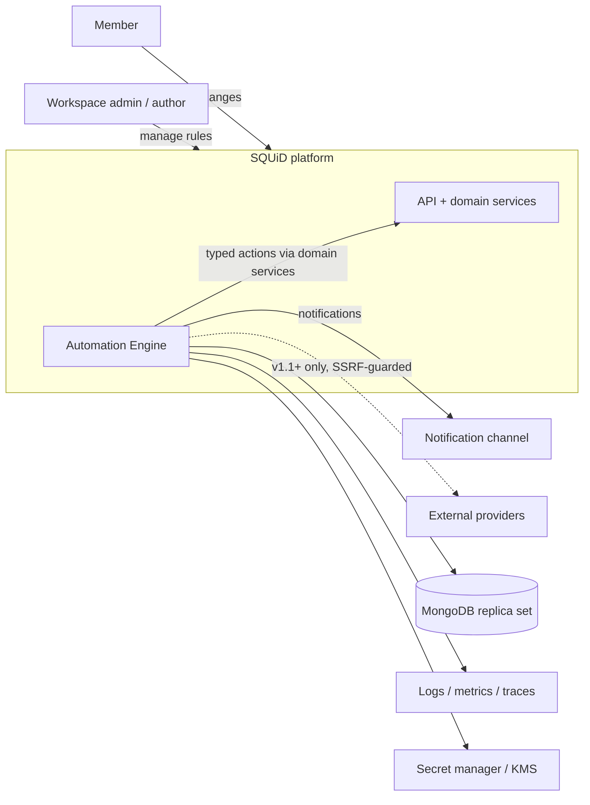
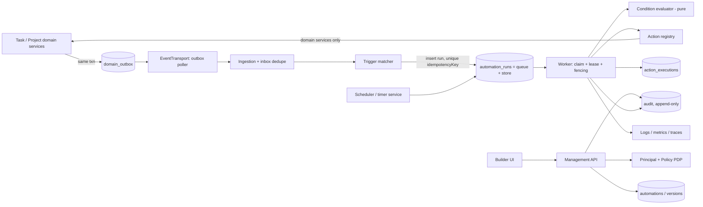
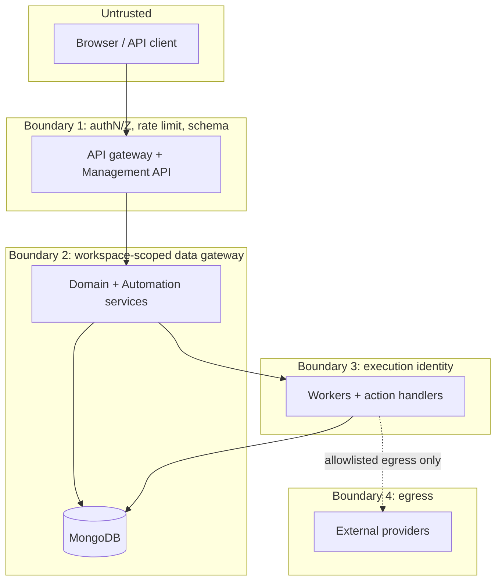
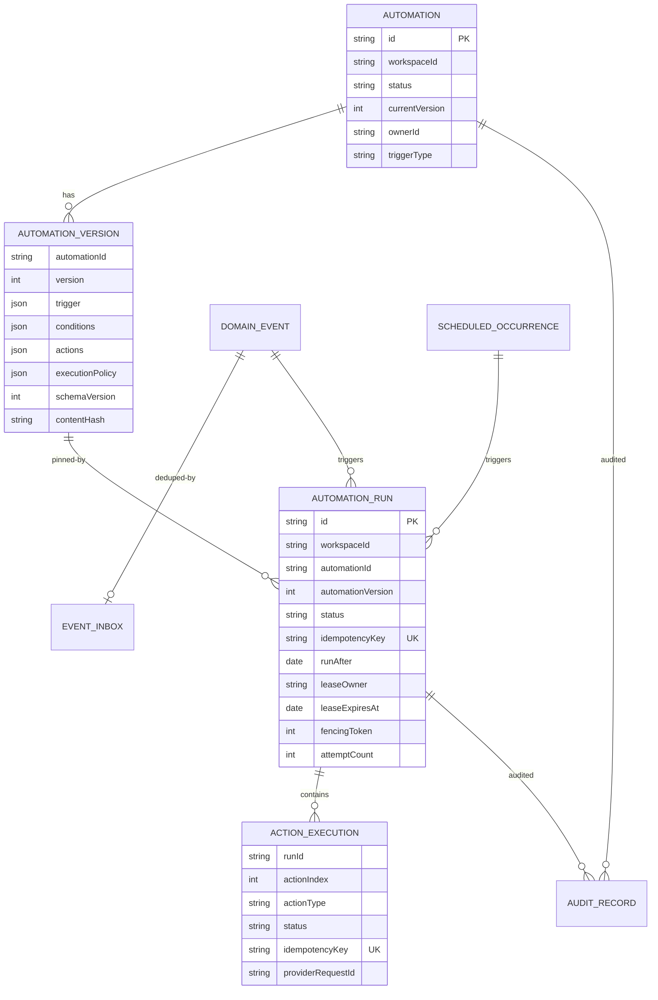
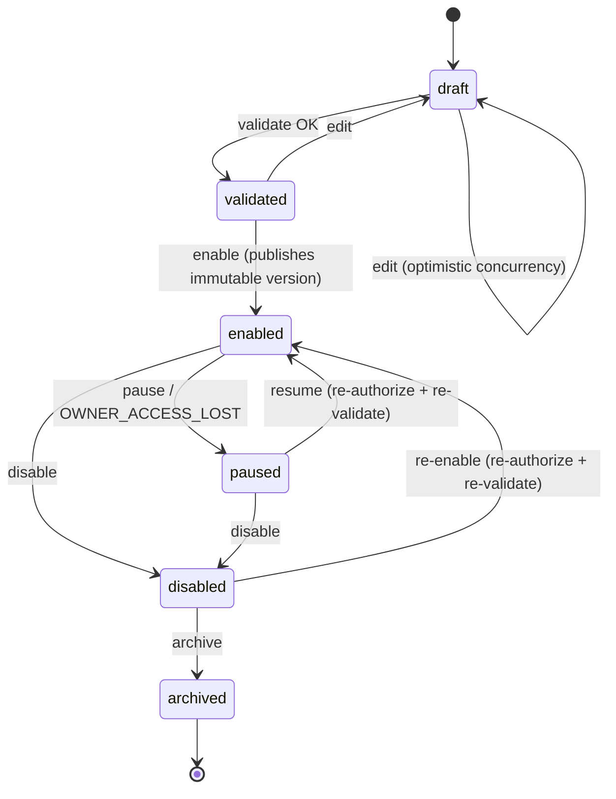
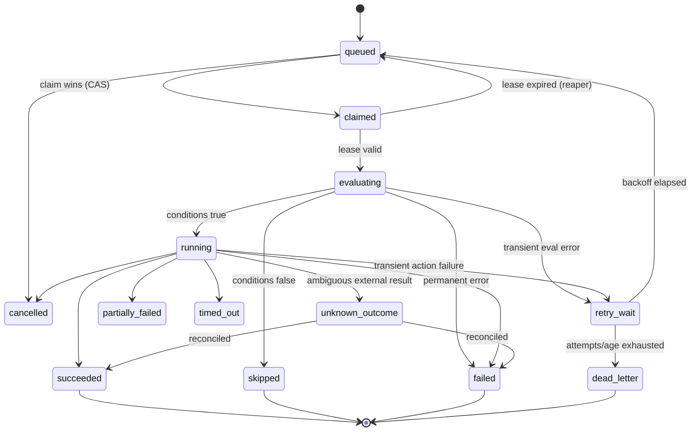
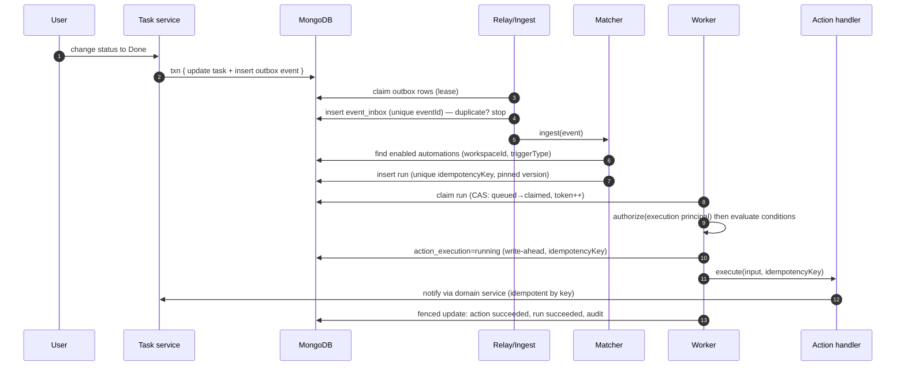
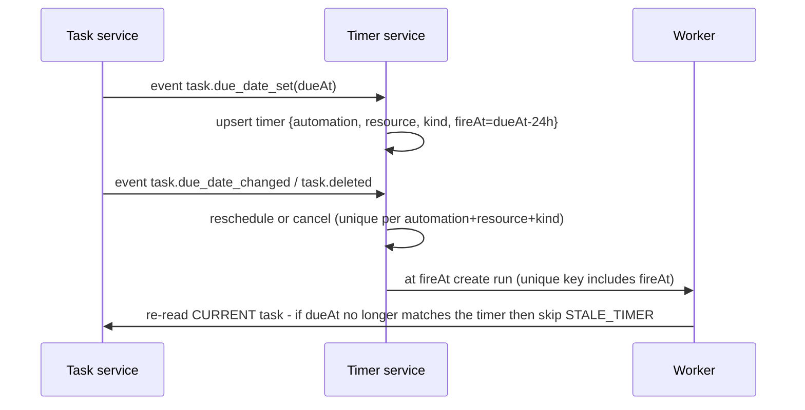

# Automation Engine — Engineering Specification v2.0

**Document ID:** AUTO-ARCH-001
**Version:** 2.0 (consolidates v1.1 + v1.2 gap review; corrected; implementation-ready baseline)
**Status:** Proposed defaults — becomes *Accepted* only after AE-E00 (repository audit + ADRs) is signed off
**Audience:** Product owner, architects, backend/frontend engineers, QA, DevOps/SRE, security reviewers
**Scope:** Reusable automation engine for the SQUiD ClickUp-like work-management platform (TypeScript / Node.js / MongoDB)
**Companion files:** `automation-engine-backlog.md` (epics → stories → tasks → tests, DoR/DoD, risk register) · `starter/` (verified pure-core code + tests + local infra files)

> **Honesty rule of this document.** Every number, technology choice and policy below is a *proposed default* with a rationale. Items that depend on facts about the real repository are tagged **[VERIFY]**. Nothing here claims that implementation, load tests, restore drills or security reviews have been done.

---

## 0. What changed from v1.1 / v1.2 (changelog)

| # | Problem in v1.1 / v1.2 | Fix in v2.0 |
|---|---|---|
| 1 | Almost every decision was "TBD / confirm" — a backlog, not a spec | Section 3 gives **concrete proposed defaults** (queue, outbox, claim, identity, limits, retention, schedules) each with rationale and a "change only via ADR" rule |
| 2 | Two **conflicting FR-001…FR-016 lists** (section 3.1 vs 26.1) | One canonical catalogue (Section 5). Old 3.1 list removed |
| 3 | No real diagrams (C4/sequence/state diagrams only mentioned) | Mermaid diagrams: context, components, event sequence, run/action/automation state machines, ER model, trust boundaries |
| 4 | No fencing for lease expiry (threat listed, mitigation missing) | **Fencing token** design (Section 11.3) |
| 5 | Action handler contract undefined; dry-run vs execute not separated | Typed `ActionHandler` port with `validate / plan / execute / classifyError / reconcile` (Section 10.2) |
| 6 | Relative timers ("1 day before due date") not designed | Timer/stale-check design (Section 12) |
| 7 | Execution identity (who is the actor at run time?) left open | Decision: **delegated service principal, capped by creator's live permissions** (Section 3.2) |
| 8 | Security list had controls but no structured model | STRIDE per boundary, OWASP API Top 10 mapping, template/ReDoS/prototype-pollution rules, supply chain, privacy erasure (Section 13) |
| 9 | No concrete contracts or code to start from | Typed contracts, strict rule validator, evaluator, state-transition table, retry/idempotency, Mongo index definitions, OpenAPI skeleton — Appendix A and the `starter/` project (strict typecheck + 38 tests pass) |
| 10 | Markdown rendering bugs (lists collapsed into paragraphs) | Rewritten cleanly |
| 11 | No review "lenses" or engineering principles framework | Section 2 |
| 12 | Metrics listed without names; SLOs without burn-rate alerting | Concrete metric names, SLIs, multi-window burn-rate alerts (Section 14) |
| 13 | No local-dev / DX, config, feature-flag, kill-switch spec | Section 16 |
| 14 | Duplicate DoD/ORR/DoR sections | De-duplicated; DoD/DoR live in the backlog companion |
| 15 | v1.2 policy sections (limits, semantics, SLO, capacity, incident, retention, cost, flags, API evolution, supply chain, connectors, multi-region) sat at the end, un-integrated | Kept in full as **Part B (§18–§33)**, cross-referenced from Part A; v1.2's *not adopted* decisions preserved in Appendix B |
| 16 | v1.2 starter values differed from v1.1 prose | Single set of starter limits (§3.4) = v1.2 §37.2 |

---

## 1. Executive summary

The Automation Engine evaluates user-configured **rules** in response to **domain events** or **time**, and executes **registered, typed actions**.

A rule = **Trigger** + **Conditions** (declarative predicate) + **Actions** (ordered, typed) + **Execution policy** (timeouts, retries, limits) + **Governance** (workspace scope, owner, version, audit).

**Hard architectural stances (non-negotiable for v1):**

1. Declarative rules only — **no user-supplied code**, no `eval`, no user regex in v1.
2. Every tenant-owned read/write passes through the existing **workspace-scoped gateway** and policy engine — never a second persistence/authorization path.
3. **At-least-once** everywhere; correctness comes from idempotency, not from hoping for exactly-once.
4. Every run is **pinned to an immutable rule version**.
5. Workers crash and external calls have ambiguous outcomes — both are first-class states.
6. Start as a **modular monolith + separate worker process**; extract services only on measured need.

### Goals
- Authorized users can author, validate, dry-run, enable, pause, inspect automations.
- Execution is asynchronous and never blocks task APIs.
- Tenant isolation at every boundary (API, event, queue, run, action, log).
- Safe under duplicate delivery, retries, restarts, partial failure, and rule loops.
- End-to-end traceability: source event → run → action attempt → audit.
- Simple enough to operate; scalable horizontally later.

### Non-goals (v1)
Arbitrary code/scripting; unbounded loops or recursion; BPMN/human-approval workflows; exactly-once claims for external APIs; microservice-per-domain; generic outbound HTTP/webhook action (deferred to v1.1, needs SSRF controls from Section 13.5).

---

## 2. Engineering lenses and principles

### 2.1 Review lenses (use these in every design/PR/architecture review)

| Lens | Core questions | Where covered | Evidence required before "Done" |
|---|---|---|---|
| **Correctness / invariants** | What must always be true? What breaks it on retry, crash, reorder? | §7, §11 | State-machine tests, property tests |
| **Security** | Who can do what to whose data? What if input is hostile? | §13 | Threat model, tenant-matrix tests, scans |
| **Reliability / resilience** | What if a worker, DB, provider, or clock misbehaves? | §11, §15–§16 | Chaos/resilience tests, drills |
| **Data** | Schema, indexes, consistency, migration, retention, privacy | §9, §13.7, Part B §24 | Query-plan review, migration test |
| **Performance / capacity** | Throughput, latency, fan-out, burst, cost per run | Part B §22 | Load test vs targets |
| **Operability** | Can on-call detect, diagnose, mitigate at 3 a.m.? | §14, §16 | Dashboards, alerts, runbooks, drill |
| **Maintainability / evolvability** | Boundaries, contracts, versioning, deletion cost | §6, §8, Part B §27 | Architecture tests, ADRs, contract tests |
| **Product / UX** | Is behavior explainable to a user? Are failures safe to show? | §10.5, §8.4 | Acceptance criteria, error catalogue |
| **Privacy / compliance** | Is personal data minimized, retained correctly, erasable? | §13.7, Part B §24 | Retention job tests, DSAR runbook |
| **Cost** | What stops runaway usage/storage? | §3.4, Part B §25 | Quotas, usage metrics |
| **Accessibility** | Can the builder be used by keyboard/screen reader? | Part B §31 | WCAG 2.2 AA checks |
| **Developer experience** | New engineer productive in a day? | §16.2 | One-command local setup |

### 2.2 Principles

1. **Invariants before endpoints.** Write the invariant (e.g. "one logical run per (automation version, source event)") then the test, then the code.
2. **Make the wrong thing impossible.** Workspace scope is a required parameter of the repository type, not a convention.
3. **Fail closed.** Missing scope, unknown action, unparseable rule, unknown schema version → reject, never "best effort".
4. **Ports and adapters (hexagonal).** Domain core is pure (no Mongo, no clock, no random); infrastructure is injected. This makes the evaluator, state machine and retry logic unit-testable without I/O.
5. **Explicit over implicit.** Time, IDs, randomness and the principal are injected dependencies.
6. **Idempotency by design.** Every effect has a deterministic idempotency key stored under a unique constraint.
7. **Parse, don't validate.** Untrusted JSON is parsed once at the boundary into a typed, versioned, immutable domain object.
8. **Smallest viable action catalogue.** Each new action ships with schema, permission, retry classification, tests, docs, metrics.
9. **Observable by default.** No feature merges without logs/metrics/trace/audit and redaction tests.
10. **Reversible and incremental.** Expand/contract migrations, feature flags, kill switch, canary.
11. **Evidence over assertion.** "Production-ready" requires measured evidence (tests, load, restore drill), never a document.
12. **Boring technology first.** Reuse what the repo already runs; add infrastructure only with an ADR justified by measurement.

---

## 3. Proposed decisions (defaults) — the part v1.1 left open

Each row is a **proposed default**. Change only through an ADR. **[VERIFY]** = depends on the real repo.

### 3.1 Architecture and infrastructure

| ID | Decision | Rationale | Fallback / when to revisit |
|---|---|---|---|
| D-01 | **Modular monolith + 1 worker process type** (same codebase, different entrypoint) | Lowest ops cost; boundaries enforced by code, not network | Extract worker/scheduler to services only if scaling or ownership demands |
| D-02 | **MongoDB is the system of record for outbox, inbox, runs and actions** (no new broker in v1). **[VERIFY]** the deployment is a replica set (or Atlas) so multi-document transactions exist | Reuses existing infra; run history must be durable anyway; the atomic outbox needs transactions | If transactions are unavailable this is a **release blocker** to resolve in an ADR: either move to a replica set, or run a documented *degraded mode* (domain write, then outbox write, plus a reconciliation scanner that detects mutations without events). Never silently assume transactions |
| D-03 | **Transactional outbox** written in the same transaction as the domain mutation | Removes dual-write problem | Reconciliation scanner for any gap |
| D-04 | **`EventTransport` port** with a `MongoOutboxTransport` adapter (poll + lease claim) | Lets us swap to BullMQ/SQS/Kafka later without touching domain code | Move when queue age SLO cannot be met by polling |
| D-05 | **Run store doubles as execution queue** (`automation_runs` with `status`, `runAfter`, lease fields) | One durable source of truth; no split-brain between queue and store | Move to broker only if claim contention is measured as the bottleneck |
| D-06 | **Lease + fencing token** worker claim (Section 11.3) | Safe against lease expiry while old worker is alive | — |
| D-07 | Redis (if present) only for rate limits/cache/leader hints — never source of truth | Avoid data loss/inconsistency | — |
| D-08 | Polling relay first (e.g. 250–1000 ms adaptive); Change Streams later | Simpler failure model, no resume-token management | Adopt Change Streams if poll cost/latency is a problem |
| D-09 | **Logic-less templates** (Mustache-style, HTML-escaped, allowlisted variables, no helpers) | Prevents template injection / code exec | — |
| D-10 | **No user regex, no scripting** in v1 conditions | ReDoS/CPU DoS | Add RE2-based `matches` with length caps via ADR |

### 3.2 Security and policy decisions

| ID | Decision | Rationale |
|---|---|---|
| D-11 | **Execution identity = delegated service principal** `automation:{automationId}` acting in the automation's workspace. Effective permission = **intersection of (action's required permission) and (the creator's *current* permission)**, re-checked at every run. | Avoids "acts with stale/elevated rights"; mirrors GitHub-Actions / ClickUp-style automation actors |
| D-12 | If the **creator loses access or is removed**, the automation auto-**pauses** with reason `OWNER_ACCESS_LOST` and notifies workspace admins; ownership can be transferred by an admin | Prevents orphaned, over-privileged automations |
| D-13 | Automation-generated events carry `origin: { automationId, runId, hop }`; **default: automation-generated events do NOT trigger automations** unless the trigger opts in (`allowAutomationOrigin: true`) and hop ≤ max | Safe default; chains are explicit |
| D-14 | Secrets: **references only** (`secretRef`), resolved at execution inside the worker, envelope-encrypted at rest (KMS), never logged | See §13.4 |
| D-15 | Replay/retry endpoints require a **separate permission** (`automation.run.replay`), reason text, and produce audit; replay of non-idempotent actions requires explicit per-action confirmation | Prevents repeated payments/emails |

### 3.3 Product-behaviour decisions (defaults — product owner to ratify)

| ID | Question | Proposed default |
|---|---|---|
| D-20 | In-flight run when automation is paused/disabled | **Finish the currently executing action, skip remaining actions**, mark run `cancelled` with reason `AUTOMATION_DISABLED`. Queued runs not yet started are cancelled. |
| D-21 | Rule edited while runs exist | New version; queued/in-flight runs stay **pinned** to old version (BR-003). Queued-not-started runs may be re-pinned only if admin chooses "apply to queued". Default: no. |
| D-22 | Missed schedule (outage) | **Coalesce**: run once for the most recent missed occurrence if within `catchUpWindow` (default 1 h), otherwise skip and record `MISSED_SKIPPED` |
| D-23 | DST: non-existent local time (spring forward) | Run at the first valid instant after the gap |
| D-24 | DST: ambiguous local time (fall back) | Run **once**, at the first occurrence |
| D-25 | Event snapshot vs live state | Conditions evaluate the **event snapshot**; actions that mutate a resource re-read **current state** and apply a **precondition** (e.g. `status == snapshot.currentStatus`); if it changed → action `skipped` with `STALE_PRECONDITION` (configurable per action: `onStale` = `skip` or `apply`) |
| D-26 | Partial failure | Default `onActionFailure: stop`; run = `partially_failed` if ≥1 action succeeded |
| D-27 | Retention | Aligned with the data-lifecycle policy in Part B (§24): run/action history **30 days searchable (provisional)**; raw event payloads **not stored by default** (candidate 7 days if required, redacted); inbox dedupe **longer than max replay/redelivery window**; outbox kept until confirmed publication + recovery buffer; audit **policy-approved period** and never removed by operational TTL. Active, `retry_wait` and `unknown_outcome` runs are never purged |
| D-28 | Quota exceeded | Reject new runs with `AUTOMATION_QUOTA_EXCEEDED` recorded as a `skipped` run (visible to user), alert admins at 80% |

### 3.4 Starter limits (provisional)

These are the **starter values from Part B §18 (v1.2 §37.2)**, restated here so implementation can begin. They are guardrails for a first build and abuse testing — **not** plan entitlements, SLAs or final production limits. Put them in one typed, environment-aware config object (never scattered constants), enforce them in the backend (UI display is not enforcement), and revise via ADR after load tests.

| Limit | Starter value | Enforced at |
|---|---:|---|
| Encoded rule/request payload | 64 KiB | API parser + schema validation |
| JSON nesting depth | 10 | Parser, before validation |
| Condition-tree depth / groups / total nodes | 5 / 10 / 50 | Draft validation + publish |
| Single string field / array values in rule config | 4 KiB / 100 | Schema validation |
| Actions per run | 10 | Draft validation + orchestrator |
| Per-action timeout (internal / external) | 5 s / 10 s | Orchestrator |
| Run deadline (synchronous action chain) | 60 s | Orchestrator |
| Max attempts (**total, including the first**) | 5 | Retry policy |
| Backoff | exponential, full jitter, capped, honour `Retry-After` | Retry policy |
| Max chain hops | 5 (plus per-chain execution budget) | Matcher + orchestrator |
| Minimum schedule interval | 1 minute | Schedule validator |
| Lease TTL / renew interval / clock-skew allowance | 60 s / 20 s / 5 s *(technical default, tune by test)* | Worker |
| Per-workspace concurrent runs / enabled automations / runs per hour | configurable; **no universal number** — choose from load test and plan policy | Worker gate + quota service |
| API burst | token bucket; numeric rates from usage data | Gateway rate limiter |

Per-plan quotas (Free/Pro/Business/Enterprise), provider circuit-breaker percentages, dollar thresholds, and multi-region/RTO/RPO numbers are **intentionally not defined here** (see Appendix B for why).

---

## 4. Product scope and personas

**Personas:** Workspace admin/owner · Automation author · Member (beneficiary) · Auditor/support operator · Platform operator (SRE).

**Initial use cases (first-release catalogue):**
1. Task moves to `Done` → notify owner/project lead. *(first vertical slice)*
2. Task created with priority `Urgent` → assign triage user.
3. Due date approaching → send reminder (timer trigger, §12).
4. Task overdue → change field / notify.
5. Form/request arrives → create task from validated template.
6. Status changes → append comment / update controlled field.
7. Scheduled rule over a bounded set of eligible resources.

**First-release action catalogue (intentionally small):** `notification.send`, `task.update_field` (allowlisted fields), `task.assign`, `task.add_comment`, `task.create_from_template`.
**Out of scope until designed:** arbitrary DB writes; actions bypassing domain services/authorization; secrets in rule JSON; user code; unbounded recurrence/bulk operations; outbound HTTP/webhook (v1.1).

---

## 5. Requirements

The canonical requirement catalogue (FR, NFR, BR, constraints) follows. IDs are the single source of truth for traceability.

### 5.1 Functional requirements (expanded)

| ID | Requirement | Priority | Verification evidence |
|---|---|---|---|
| FR-001 | Authorized workspace members can create/read/update/duplicate/archive automations | P0 | API integration and permission tests |
| FR-002 | Every automation has a single authoritative workspace scope and owner | P0 | Schema + cross-workspace tests |
| FR-003 | Definitions support trigger, conditions, ordered actions, execution policy, schema version | P0 | Schema/unit tests |
| FR-004 | Trigger/action/operator configurations are checked against registered typed schemas | P0 | Positive/negative validation tests |
| FR-005 | Draft validation returns stable error codes and field paths | P0 | Contract tests |
| FR-006 | Validated immutable versions can be enabled; runs pin the version | P0 | Lifecycle/version integration tests |
| FR-007 | Domain events can create matching eligible runs asynchronously | P0 | End-to-end event test |
| FR-008 | Duplicate event delivery does not create duplicate logical runs | P0 | Unique-key/idempotency integration test |
| FR-009 | Conditions support bounded typed operators and deterministic null/missing semantics | P0 | Unit/property tests |
| FR-010 | Actions are executed only via approved registry handlers | P0 | Registry and negative tests |
| FR-011 | Run/action status, attempts, timestamps, failure code and correlation IDs are persisted | P0 | Repository/integration tests |
| FR-012 | Transient failures retry under a bounded policy; permanent failures stop retrying | P0 | Retry classifier tests |
| FR-013 | Exhausted or poison work is recorded for authorized inspection/recovery | P0 | DLQ tests |
| FR-014 | Management supports pause, resume, disable, archive and documented in-flight semantics | P0 | State transition tests |
| FR-015 | Users can view paginated run history and safe action outcomes | P0 | API contract/E2E tests |
| FR-016 | Authorized manual retry/replay is audited and protected against duplicate effects | P1 | Security/replay tests |
| FR-017 | Dry-run previews condition outcomes and planned actions without production mutations | P1 | No-side-effect test |
| FR-018 | Scheduled triggers support explicit time zone, DST and missed-run policy | P1 | Clock-controlled scheduler tests |
| FR-019 | Loop/fan-out budgets limit recursive or excessive execution | P0 | Loop/circuit-breaker tests |
| FR-020 | Quotas and rate limits exist globally and per workspace/integration | P1 | Throttle/fairness tests |
| FR-021 | Automation configuration supports controlled schema evolution/migration | P1 | Compatibility/migration tests |
| FR-022 | Run data and logs obey retention and redaction policies | P1 | Retention/redaction tests |
| FR-023 | The system supports an operational pause/kill switch | P0 | Incident drill |
| FR-024 | Users can identify why a rule matched, skipped, failed, or was retried without exposing secrets | P1 | UX + API tests |

### 5.2 Non-functional requirements (expanded)

| ID | Requirement | How to verify |
|---|---|---|
| NFR-001 Availability | Agree a target for the management API and separately for asynchronous execution | SLO definition and monthly reporting |
| NFR-002 Latency | Agree p95/p99 targets for management APIs, ingestion/enqueue, queue wait and action execution | Load test + telemetry |
| NFR-003 Durability | Define which acknowledgement means an event/job is accepted and persisted | Crash/restart test, queue/outbox documentation |
| NFR-004 Tenant isolation | No resource read/write/log access across workspaces | Adversarial integration tests |
| NFR-005 Scalability | Workers scale without duplicate ownership and maintain per-tenant fairness | Load/scale tests |
| NFR-006 Observability | Correlation across event → run → action attempt | Trace/log acceptance test |
| NFR-007 Security | Least privilege, input bounds, secret handling, replay controls | Threat model + security test suite |
| NFR-008 Recoverability | Define and exercise RPO/RTO; no unsupported claims | Restore and failure drills |
| NFR-009 Maintainability | Module boundaries, documented contracts, reproducible builds | CI/architecture tests/review |
| NFR-010 Cost | Run/action/fan-out quotas and retention limits | Cost/usage metrics, quota tests |
| NFR-011 Compatibility | Versioned events/rules/API and documented deprecation window | Contract/compatibility tests |
| NFR-012 Accessibility | Builder and run history support keyboard navigation and accessible labels where UI is in scope | Accessibility checks/manual verification |
| NFR-013 Privacy | Minimize personal data in event snapshots and define deletion/retention policy | Privacy review and redaction tests |
| NFR-014 Operability | Runbooks, alerts, kill switch, dashboards, incident ownership are available | Operational readiness review |

### 5.3 Business rules (BR)

- **BR-001:** An automation and every run/action record belong to one workspace.
- **BR-002:** An executable run references one immutable automation version.
- **BR-003:** A published version cannot be edited in place; edits create a new version.
- **BR-004:** Missing/invalid workspace scope fails closed.
- **BR-005:** Management authorization and execution authorization are checked independently.
- **BR-006:** Every action type is registered, schema-validated, permission-checked, and bounded.
- **BR-007:** Retry policy is bounded by attempts and total age.
- **BR-008:** Any external action with ambiguous outcome enters reconciliation or a safe idempotent retry path.
- **BR-009:** All manual replays, overrides, enables, disables, and sensitive changes are audited.
- **BR-010:** Recursion/fan-out cannot exceed configured limits.
- **BR-011:** Schedules use an explicit IANA timezone; storage/queue timestamps use UTC.
- **BR-012:** Pausing/disabling affects future work and in-flight runs according to an explicitly chosen policy.

### 5.4 Constraints and assumptions

| ID | Constraint / assumption | Handling |
|---|---|---|
| CON-001 | Existing SQUiD modules/contracts take precedence over a new design | Audit repository before choosing package names or interfaces |
| CON-002 | Existing workspace gateway and principal/policy mechanisms must not be bypassed | Architecture tests and code review |
| CON-003 | No arbitrary user code in the first release | Declarative DSL and action registry |
| CON-004 | MongoDB transaction support depends on actual deployment topology/configuration | Verify replica set/transaction support; choose documented alternative if absent |
| CON-005 | At-least-once delivery is the default model | Deduplication and idempotent effects |
| CON-006 | Exactly-once external side effects cannot be generally guaranteed | Provider idempotency/reconciliation/unknown outcome state |
| CON-007 | Queue, scheduler, broker, and deployment technology are not finalized by this document | ADR after repository audit and expected-load review |
| CON-008 | Performance targets are hypotheses until benchmarked | Establish baseline before release commitments |
| CON-009 | First release action list should remain intentionally small | Add action types only with schema, permissions, tests, docs and metrics |
| CON-010 | Personal data and secrets should not be copied into durable events without need | Data minimization and redaction review |

---

---

## 6. Architecture

### 6.1 System context



### 6.2 Logical components



### 6.3 Trust boundaries (used by the threat model, §13)



### 6.4 Module and package boundaries (hexagonal; **[VERIFY]** names against the real monorepo)

| Package / module | Contains | May depend on | Must NOT depend on |
|---|---|---|---|
| `automation-contracts` | Types, Zod schemas, event/action schemas, error codes, limits config types | nothing (zero runtime deps beyond zod) | everything else |
| `automation-core` | **Pure domain**: state machines, condition evaluator, retry policy, idempotency-key builder, DSL parser. No I/O, no clock, no random (injected) | contracts | Mongo, HTTP, Node `fs`/`net`, logger impl |
| `automation-application` | Use cases (create draft, publish, ingest event, match, claim, execute run), **ports** (`RunRepository`, `EventTransport`, `PolicyPort`, `Clock`, `SecretPort`, `ActionHandler`) | core, contracts | infrastructure adapters |
| `automation-infra-mongo` | Adapters using the **scoped data gateway**; indexes; migrations | application, contracts | domain UI, API |
| `automation-actions` | Built-in `ActionHandler`s; each calls **domain services** (never raw collections) | application, contracts | other handlers |
| `automation-api` | HTTP routes, DTO mapping, OpenAPI | application | infra-mongo directly |
| `automation-worker` | Process entrypoints: relay, ingest, executor, scheduler, reaper | application, infra, actions | api |

Dependency direction is **inward** (infra → application → core → contracts). Enforce with an automated architecture test (e.g. `dependency-cruiser` / ESLint boundaries) that fails CI on violation, and with one more test asserting that **no module outside the data gateway imports the Mongo driver**.

### 6.5 Process topology

- `api` process(es): management API + domain services (+ outbox writes).
- `worker` process(es): same codebase, role flags select which loops run — `relay`, `ingest`, `executor`, `scheduler`, `reaper`. Scale `executor` horizontally; `scheduler` runs leader-elected via a Mongo lease document.
- MongoDB replica set; Redis optional (rate limits/cache only); secret manager; telemetry backend.
- Do not add Kafka, Kubernetes, or extra services to look "production-grade"; introduce infrastructure through an ADR tied to measured need (Part B §30 lists decision triggers).

---

## 7. Domain model, invariants and state machines

### 7.1 Core invariants (each must have at least one automated test)

| ID | Invariant |
|---|---|
| INV-01 | Every tenant-owned record has exactly one trusted `workspaceId`; every read/write requires it; a missing scope fails closed **before** a driver call |
| INV-02 | A published `AutomationVersion` is immutable (`contentHash` verified on load) |
| INV-03 | At most **one logical run** per `(automationId, version, sourceEventId \| scheduledOccurrenceId)` |
| INV-04 | At most one worker may commit state for a run at a time (lease + fencing token) |
| INV-05 | At most one logical effect per `(runId, actionIndex)` — enforced by an idempotency key, not by hope |
| INV-06 | Run/action state changes follow the transition table (Part B §20); illegal transitions are rejected and logged |
| INV-07 | Execution authorization is re-evaluated at run time; authoring-time permission is never trusted |
| INV-08 | No secret or raw sensitive payload appears in logs, traces, audit, or user-visible errors |
| INV-09 | Accepted events are never silently dropped; they end as matched, ignored-by-rule, rejected, or quarantined |
| INV-10 | Automation-origin events cannot create unbounded chains (hop limit + execution budget) |

### 7.2 Entities (logical)



Field-level definitions are in §9 and Appendix A (Zod contracts).

### 7.3 Automation lifecycle



Editing an `enabled` automation creates a **new draft derived from the current version**; enabling it publishes version N+1 atomically and retargets future matching. Existing runs stay pinned (D-21).

### 7.4 Run lifecycle



The authoritative guard table is **Part B §20**; the code form is Appendix A (`run-transitions.ts`) and is generated into tests so the diagram, table and code cannot drift.

### 7.5 Action lifecycle

`pending → running → succeeded | retry_wait | failed | skipped | timed_out | unknown_outcome`

`unknown_outcome` = we *may* have caused the effect but never saw the confirmation. Resolution order: (1) provider/domain idempotency key makes a retry safe → retry; (2) provider status lookup via `reconcile()` → mark succeeded/failed; (3) neither possible → surface to a human, never auto-repeat a non-idempotent effect.

### 7.6 End-to-end sequence (first vertical slice)



---

## 8. Rule model and evaluator

### 8.1 Rule document (schema version 1)

```json
{
  "schemaVersion": 1,
  "name": "Notify project lead when a task is completed",
  "trigger": {
    "type": "task.status_changed",
    "config": { "toStatus": "done", "allowAutomationOrigin": false }
  },
  "conditions": {
    "all": [
      { "field": "task.isArchived", "op": "eq", "value": false },
      { "field": "task.priority", "op": "in", "value": ["high", "urgent"] }
    ]
  },
  "actions": [
    {
      "type": "notification.send",
      "config": {
        "recipient": { "type": "project_lead" },
        "template": "task_completed"
      },
      "onStale": "skip"
    }
  ],
  "executionPolicy": {
    "onActionFailure": "stop",
    "maxAttempts": 5
  }
}
```

Notes: `workspaceId` is **never** part of the rule body or condition fields — scope comes only from the server-built trusted context. There is no `valueFrom: trusted_scope` trick in rule JSON (v1.1 example removed: letting a rule compare against scope fields invites confusion with authorization).

### 8.2 Condition language

- Operators (v1): `eq, ne, in, not_in, exists, not_exists, gt, gte, lt, lte, before, after`, groups `all`, `any`, and `not` (single child).
- Field paths come from a **per-trigger allowlist** (generated from the event schema). Paths are resolved with own-property lookups on a null-prototype copy — never `obj[userString]` on a live object (prototype pollution: `__proto__`, `constructor`, `prototype` are rejected at validation and at runtime).
- **No coercion, null-vs-missing table, empty-group rejection, three-valued result (`true / false / evaluation_error`), UTC/date rules**: normative text is Part B §19 (v1.2 §38). Dry-run, API validation and worker must call the **same pure evaluator function**; a test runs one fixture corpus through all three call paths.
- No regex, no arithmetic expressions, no function calls, no user-defined variables in v1.

### 8.3 Validation pipeline (publish-time)

1. AuthN → resolve workspace principal → check `automation.create|update`.
2. Reject oversize/over-deep payload **before** schema validation (limits §3.4).
3. Parse into a typed object with a **strict** schema — unknown keys rejected, never silently stripped (the `starter/` validator is dependency-free; Zod `.strict()` is an acceptable equivalent at the API edge).
4. Trigger type/config vs. registry; field allowlist; operator/type compatibility.
5. Each action: registered type, config schema, required permission, secret refs exist and belong to the workspace.
6. Cross-rules: action count, hop/loop analysis (§11.7), schedule interval ≥ minimum, template variables ⊆ allowlist.
7. Compute `contentHash` over canonical JSON (sorted keys) → store version immutable.
8. Return **stable error codes with JSON-pointer paths** (e.g. `AUTOMATION_INVALID_CONDITION` at `/conditions/all/1/op`).

### 8.4 Dry-run

Calls `evaluate()` and each handler's side-effect-free `plan()`. Reports: trigger match + why, per-condition result with redacted values, planned actions + required permissions, estimated fan-out/quota impact, loop warnings. Output goes through the same redaction as logs. A dry-run can never write to production resources and can never call `execute()` (enforced by passing handlers a `DryRunContext` that has no effect-capable ports).

---

## 9. Data model and persistence

### 9.1 Collections

| Collection | Purpose | Notes |
|---|---|---|
| `automations` | Mutable header (status, owner, currentVersion) | Optimistic concurrency via `rev` |
| `automation_versions` | Immutable published versions | Never updated; `contentHash` |
| `automation_runs` | Run state **and** execution queue | Lease + fencing fields |
| `action_executions` | One row per `(runId, actionIndex)` | Write-ahead before effect |
| `domain_outbox` | Events written in the domain transaction | Claimed by relay |
| `event_inbox` | Dedupe record (`eventId` unique) | Retention > replay window |
| `scheduled_occurrences` + `schedule_cursors` | Time triggers | §12 |
| `automation_timers` | Relative/due-date timers | §12.3 |
| `automation_audit` | Append-only audit | Separate DB role: insert/read only |
| `workspace_limits_usage` | Concurrency/quota counters | Reconciled by reaper |
| `integration_connections` | Secret **references** + metadata | No plaintext secrets |

### 9.2 Indexes (starting point; confirm with `explain()` on real data)

| Collection | Index | Why |
|---|---|---|
| `automations` | `{workspaceId:1, status:1, triggerType:1}` | Trigger matching |
| `automations` | unique `{workspaceId:1, normalizedName:1}` **only if** product requires unique names | |
| `automation_versions` | unique `{workspaceId:1, automationId:1, version:1}` | Immutability + lookup |
| `automation_runs` | unique `{idempotencyKey:1}` | **INV-03** |
| `automation_runs` | `{status:1, runAfter:1}` (partial: `status in [queued, retry_wait]`) | Claim scan |
| `automation_runs` | `{status:1, leaseExpiresAt:1}` (partial: `claimed, evaluating, running`) | Reaper |
| `automation_runs` | `{workspaceId:1, automationId:1, createdAt:-1}` | Run history |
| `automation_runs` | `{workspaceId:1, status:1, createdAt:-1}` | Ops filters |
| `action_executions` | unique `{workspaceId:1, runId:1, actionIndex:1}` | **INV-05** |
| `domain_outbox` | `{publishedAt:1, claimUntil:1, createdAt:1}`; unique `{eventId:1}` | Relay |
| `event_inbox` | unique `{eventId:1}` (or `{workspaceId, eventId}` if the contract allows) | **INV-09** |
| `scheduled_occurrences` | unique `{automationId:1, scheduledFor:1}` | One occurrence |
| `automation_timers` | `{fireAt:1, status:1}`; unique `{automationId:1, resourceId:1, kind:1}` | Timer claim + reschedule |

Avoid indexes not tied to a measured access pattern. TTL indexes only on data that is eligible and never on audit, active runs or outbox rows that are unpublished.

### 9.3 Persistence rules

1. Every query/mutation goes through the **workspace-scoped data gateway** `[VERIFY]`; the repository method signature takes a `WorkspaceScope` value (branded type) that can only be produced by the principal resolver.
2. Client-provided `workspaceId` is never proof of anything; compare path/body ID to the resolved principal scope and reject mismatches (BOLA/IDOR).
3. Optimistic concurrency (`rev`) on definition edits and status changes; a zero-match conditional update is **not success**.
4. Transactions for: domain mutation + outbox; publish version + automation header update; claim bookkeeping that touches multiple docs. Otherwise design explicit reconciliation.
5. Keep run history separate from mutable definitions; bound and redact stored input/output snapshots.
6. Secrets: store `secretRef` only.
7. Use majority write concern for outbox/runs/audit and `readConcern: majority` where a stale read could cause a duplicate or skipped effect `[VERIFY with deployment]`.
8. Time: store UTC `Date`; schedules store IANA zone separately.

### 9.4 Conditional claim (illustrates the contract; full code in Appendix A)

```ts
// claim: queued -> claimed, bump fencing token, set lease. Zero matches = lost race, NOT success.
const claimed = await runs.findOneAndUpdate(
  { status: { $in: ['queued'] }, runAfter: { $lte: now } /* + fairness filter */ },
  { $set: { status: 'claimed', leaseOwner: workerId, leaseExpiresAt: addMs(now, LEASE_TTL_MS) },
    $inc: { fencingToken: 1, attemptCount: 1 } },
  { sort: { runAfter: 1 }, returnDocument: 'after' }
);
// every later write: { _id, fencingToken: claimed.fencingToken, status: <expected> } — a stale worker matches 0 docs.
```

---

## 10. Contracts: events, actions, API

### 10.1 Domain event envelope (versioned)

```ts
interface DomainEvent<T = unknown> {
  eventId: string;            // globally unique (UUIDv7/ULID) — dedupe key
  eventType: string;          // e.g. "task.status_changed"
  schemaVersion: number;      // per eventType
  workspaceId: string;        // set by the producing service from trusted scope
  aggregateType: string;      // "task"
  aggregateId: string;
  aggregateVersion: number;   // optimistic version of the aggregate at emit time
  occurredAt: string;         // ISO-8601 UTC
  actor: { type: 'user' | 'automation' | 'system'; id: string };
  origin?: { automationId: string; runId: string; hop: number }; // present iff automation-generated
  correlationId: string;
  causationId?: string;
  payload: T;                 // minimal, validated, size-bounded (no secrets, minimal PII)
}
```

Rules: additive evolution only (optional fields); breaking change ⇒ new `schemaVersion` with a compatibility window (Part B §27). Ordering is **not guaranteed** across aggregates; per-aggregate order is only best-effort — conditions must be written against the snapshot, and handlers use `aggregateVersion`/preconditions to detect stale state (D-25).

### 10.2 Action handler port (the contract every action implements)

```ts
interface ActionHandler<C, R> {
  readonly type: string;                       // "task.update_field"
  readonly schemaVersion: number;
  readonly configSchema: ZodType<C>;           // strict
  readonly resultSchema: ZodType<R>;           // safe, redactable
  readonly requiredPermission: (cfg: C) => PermissionRequest;
  readonly sideEffect: 'none' | 'internal-idempotent' | 'internal' | 'external-idempotent' | 'external';
  readonly timeoutMs: { internal?: number; external?: number };

  validate(cfg: C, ctx: ValidationContext): ValidationIssue[];          // authoring time
  plan(cfg: C, ctx: DryRunContext): PlannedEffect;                       // pure, no I/O effects
  execute(cfg: C, ctx: ExecutionContext, idempotencyKey: string): Promise<ActionOutcome<R>>;
  classifyError(err: unknown): 'transient' | 'permanent' | 'ambiguous';  // drives retry / unknown_outcome
  reconcile?(cfg: C, ctx: ExecutionContext, idempotencyKey: string): Promise<'applied' | 'not_applied' | 'unknown'>;
}
```

Registration is **fail-closed**: an action without schema, permission mapping, redaction rules, and timeout does not register. Every handler calls **domain services** with the execution principal (never repositories directly) and passes the idempotency key so the domain service can dedupe (e.g. notification unique key).

### 10.3 Management API

Base: `/api/v1/workspaces/{workspaceId}/…` (path `workspaceId` is compared against the resolved principal scope; mismatch → `404`, not `403`, to avoid resource enumeration).

| Method | Path | Purpose | Notes |
|---|---|---|---|
| POST | `/automations` | Create draft | `Idempotency-Key` header |
| GET | `/automations` | List (cursor pagination, filters) | |
| GET | `/automations/{id}` | Read definition (+ current version) | |
| PATCH | `/automations/{id}` | Edit draft | `If-Match: <rev>` required |
| POST | `/automations/{id}/validate` | Validate draft | returns issues with JSON pointers |
| POST | `/automations/{id}/dry-run` | Preview against sample event | no side effects |
| POST | `/automations/{id}/enable` | Publish immutable version + enable | `Idempotency-Key`, `If-Match` |
| POST | `/automations/{id}/pause` · `/disable` · `/archive` | Lifecycle | audited |
| GET | `/automations/{id}/runs` | Run history (cursor) | |
| GET | `/automation-runs/{runId}` | Inspect run + actions | user-safe failure text only |
| POST | `/automation-runs/{runId}/retry` | Audited retry under policy | permission `automation.run.replay` |
| POST | `/automation-runs/{runId}/replay` | Controlled replay (new run, links `replayOf`) | reason required; per-action confirmation for non-idempotent |

Requirements: authN + authZ on every route; request schema validation; payload limits; stable error codes; cursor pagination; rate limits per actor/workspace/endpoint; no stack traces or provider internals in responses; OpenAPI + contract tests (skeleton in Appendix A).

### 10.4 Error catalogue (stable codes)

| Code | HTTP | Meaning |
|---|---:|---|
| `AUTOMATION_NOT_FOUND` | 404 | Not found **or not visible** in this workspace |
| `AUTOMATION_VERSION_CONFLICT` | 409 | `If-Match`/`rev` mismatch |
| `AUTOMATION_INVALID_RULE` | 422 | Schema/size/depth violation (with pointers) |
| `AUTOMATION_INVALID_TRIGGER` / `_CONDITION` / `_ACTION` | 422 | Specific validation failures |
| `AUTOMATION_LIMIT_EXCEEDED` | 422 | A §3.4 limit |
| `AUTOMATION_PERMISSION_DENIED` | 403 | Principal lacks permission |
| `AUTOMATION_QUOTA_EXCEEDED` | 429 | Quota/rate (with `Retry-After`) |
| `AUTOMATION_RUN_NOT_RETRYABLE` | 409 | State/policy forbids retry |
| `AUTOMATION_RUN_ALREADY_CLAIMED` | 409 | Concurrent claim |
| `AUTOMATION_IDEMPOTENCY_KEY_REUSED` | 422 | Same key, different payload |
| `AUTOMATION_PROVIDER_UNAVAILABLE` | 503 | Dependency down |

### 10.5 What users see on failure

User-facing failure text is a **mapped, safe message per failure code** (e.g. "Recipient no longer has access to this project"), never raw provider/driver errors. Support operators see the same plus correlation IDs; raw detail lives only in redacted, access-controlled logs.

---

## 11. Execution engine

### 11.1 Loops (worker roles)

| Role | Loop | Safety |
|---|---|---|
| `relay` | Claim unpublished outbox rows (lease) → hand to ingest → mark published | Duplicates expected and safe |
| `ingest` | Schema-validate → insert `event_inbox` (unique) → on duplicate stop → match | Malformed events quarantined, never dropped silently |
| `executor` | Claim run → authorize → evaluate → run actions → fenced commits | Fencing token on every write |
| `reaper` | Expired lease: `claimed → queued`; `evaluating`/`running → retry_wait` (reason `LEASE_EXPIRED`, preserves attempt accounting, then `retry_wait → queued`). Reconcile concurrency counters | Idempotent; bounded batch |
| `scheduler` | Leader-elected; emits occurrences/timers as runs | Unique occurrence key |

### 11.2 Matching and run creation

For event `E` in workspace `W`: query enabled automations with `(workspaceId=W, triggerType=E.type)`; skip automations whose trigger config doesn't match; enforce hop rules (D-13) and max fan-out (Part B §18). For each match insert a run with
`idempotencyKey = sha256(canonicalJSON({ w: W, a: automationId, v: version, src: eventId }))`.
A duplicate-key error means "already created" — success, not failure. Matching is a pure function over `(event, automationVersion)` plus an indexed lookup.

### 11.3 Claim, lease, **fencing** (closes the v1.1 gap)

- Claim = one atomic conditional update (`queued → claimed`) that increments `fencingToken`, sets `leaseOwner`, `leaseExpiresAt`.
- The worker renews the lease every ⅓ TTL while working; renewal also conditions on `{fencingToken, leaseOwner}`.
- **Every** subsequent state write (`evaluating`, action results, final status) includes `{_id, fencingToken}` in the filter. If a worker stalls (GC pause, network partition), the reaper returns the run to `queued`, another worker claims with `fencingToken+1`, and the stale worker's late writes match **zero** documents → it must stop immediately and emit `stale_worker_write_rejected`.
- External effects performed by a stale worker cannot be un-done, therefore **effects are protected by the action idempotency key** (11.5), not by the lease. The lease only limits duplicate *work*.
- Clock skew: lease comparisons use the database server time (`$$NOW`) wherever possible.

### 11.4 Per-workspace fairness and concurrency

A noisy workspace must not starve others. Starter design: a per-workspace in-flight counter doc incremented with a `$lt: cap` guard at claim, decremented at completion; the reaper reconciles counters from actual run states (counters are an optimisation, runs are the truth). Claim scan picks eligible runs round-robin across workspaces (e.g. sample workspaces with queued work, then oldest per workspace). Caps are configuration (§3.4), tuned by the noisy-neighbour load scenario (Part B §22).

### 11.5 Idempotency

| Layer | Key | Mechanism |
|---|---|---|
| Inbound event | `eventId` | unique `event_inbox` |
| Run creation | hash(workspace, automation, version, source) | unique `idempotencyKey` |
| Action effect | `actionKey = sha256(runIdempotencyKey + ':' + actionIndex)` | unique `action_executions`; passed to domain service/provider |
| API create/enable/retry | client `Idempotency-Key` | stored with request hash; same key + different body → `AUTOMATION_IDEMPOTENCY_KEY_REUSED` |

**Write-ahead rule:** set `action_executions.status = running` *with its key* **before** calling the handler. On crash/restart the next worker sees `running` and goes through `reconcile()` / safe retry rather than blindly repeating.

### 11.6 Retry, backoff, DLQ

- Classify via `handler.classifyError`: `transient` (timeout, 429, 5xx, connection reset), `permanent` (validation, permission, not-found, config), `ambiguous` (timeout *after* request sent to a non-idempotent provider).
- Delay = `min(cap, random(0, base × 2^attempt))` (full jitter); honour `Retry-After`. Attempts and total age bounded (§3.4). A retry **budget** per provider prevents retry storms; provider circuit-breaker thresholds are **configurable per provider** (no universal percentages).
- Exhausted ⇒ `dead_letter` (queryable by authorized users, alert on age). DLQ recovery = audited retry/replay, never delete-and-forget.
- `retry` re-runs the *same* run (new attempt, same keys → effects stay deduplicated). `replay` creates a *new* run linked via `replayOf` and therefore *new* effect keys — hence the stronger permission and confirmation (D-15).

### 11.7 Loop and fan-out control

- Authoring-time: build the graph "trigger event types → action event types"; reject direct self-cycles (an action that emits the event type that triggers the same automation), warn on indirect cycles.
- Runtime: `origin.hop` increments through automation-generated events; hop > max ⇒ run `skipped` with `HOP_LIMIT_EXCEEDED`, an audit entry, and a circuit-breaker metric. A per-chain execution budget caps total runs per root event.
- Max runs per event and per-workspace rate (quota service) bound fan-out.

### 11.8 Partial failure, cancellation, timeouts

- `onActionFailure: stop` (default) | `continue`. Run outcome `partially_failed` if ≥1 action succeeded then a later one failed.
- Pause/disable semantics: stop claiming new work → cancel not-yet-started runs → cooperative cancellation between actions (D-20). Already-completed external effects are recorded, never "rolled back".
- Deadlines: per-action timeout and per-run deadline (§3.4) enforced with `AbortSignal`; handlers must honour it. Every waiting state has a maximum age.

### 11.9 Execution-time authorization (INV-07)

At claim: build the **execution principal** (`automation:{id}` in workspace `W`); verify automation still `enabled`, creator still a member with the required permission (D-11/D-12); for each action, call `PolicyPort.authorize(principal, requiredPermission(cfg), resource)` **immediately before** `execute`. Denial ⇒ `failed` with `PERMISSION_REVOKED` (permanent, no retry), audited, and the automation is auto-paused when the cause is owner access loss.

---

## 12. Time: schedules and timers

### 12.1 Scheduled triggers

- Definition: cron-like or interval expression + **IANA zone**; minimum interval 1 minute (§3.4). Reject unsupported precision.
- Scheduler (leader-elected via Mongo lease doc) keeps a durable cursor per automation, computes the next occurrence in the zone, converts to UTC, inserts `scheduled_occurrences` with unique `(automationId, scheduledFor)`, then a run keyed by that occurrence.
- DST: D-23/D-24. Missed occurrences: D-22 (coalesce within catch-up window). Disabled/paused automations get no new occurrences.
- Fan-out over resources: an occurrence expands in **bounded pages** (cursor), each item a child run keyed by `(occurrenceId, resourceId)`; cap per occurrence (§3.4 style config) with an explicit `TRUNCATED` marker visible in run history.

### 12.2 Time sources

All logic takes `Clock` (injected). Tests use a fake clock to cover DST, leap day, month end, and clock jumps. Never `Date.now()` inside core.

### 12.3 Relative timers (e.g. "24 h before due date", "3 days overdue")



The **stale check at fire time** is mandatory: timers are hints, current state is truth.

---

## 13. Security

### 13.1 Security principles

Least privilege · deny by default · defence in depth · fail closed · validate at every trust boundary · no secrets in data/logs · everything privileged is audited · assume hostile tenants, hostile payloads and compromised dependencies.

### 13.2 Threat model — STRIDE by boundary (see §6.3)

| Boundary | Spoofing | Tampering | Repudiation | Info disclosure | DoS | Elevation of privilege |
|---|---|---|---|---|---|---|
| **1 Client→API** | Stolen/forged token → standard authN, short-lived tokens, CSRF protection for cookie auth | Mass-assignment/unknown fields → strict schemas; body size limits | Missing actor on changes → audit with actor + correlation ID | Resource enumeration → 404 for cross-workspace IDs | Rule/payload bombs, request floods → limits, token-bucket rate limits | **BOLA/IDOR** → scope compare + scoped repos; function-level checks on every route |
| **2 Service→DB** | Forged workspace scope → scope only from principal resolver (branded type) | Direct DB writes bypassing gateway → architecture test + DB roles | Audit tampering → append-only role, hash-chain optional | Cross-tenant query → tenant-matrix tests on every repo method | Unindexed scans → index review, `maxTimeMS` | Wide DB credentials → per-role least privilege |
| **3 Worker/handlers** | Worker impersonating user → execution principal is `automation:{id}`, never the human session | Rule changed after publish → immutable versions + `contentHash` verify | Replay without trace → audited replay with reason | Secrets/PII in logs, errors, traces → centralized redaction + tests | Poison run, slow handler, retry storm → timeouts, budgets, DLQ, breakers | Stale permissions → re-authorize at execution (INV-07) |
| **4 Egress (v1.1+)** | Provider impersonation → TLS verify, pinned endpoints per connector | Response injection → treat as untrusted, bound size | Unclear what was sent → request ids in `action_executions` | Token leakage → secret refs, KMS, no tokens in logs | Provider outage amplification → per-provider breaker + retry budget | **SSRF** → §13.5 |

Produce a living `security-and-threat-model.md` from this table in AE-E00; review it at every new trigger/action/connector.

### 13.3 OWASP API Security Top 10 (2023) mapping

| Risk | Control in this design |
|---|---|
| API1 BOLA | Scoped repos, path/principal scope check, tenant-matrix tests |
| API2 Broken authN | Reuse platform authN; no bespoke auth |
| API3 Broken object-property-level auth | Strict response DTOs; redaction of internal fields; no mass assignment |
| API4 Unrestricted resource consumption | Limits (§3.4), rate limits, quotas, `maxTimeMS`, pagination caps |
| API5 Broken function-level auth | Permission per route + separate `automation.run.replay` |
| API6 Unrestricted access to sensitive business flows | Replay/enable gated, audited, rate limited |
| API7 SSRF | No outbound HTTP in v1; §13.5 controls before v1.1 |
| API8 Security misconfiguration | Config validated at boot; secure defaults; no debug in prod |
| API9 Improper inventory | OpenAPI as source of truth; deprecation policy (Part B §27) |
| API10 Unsafe consumption of APIs | Provider responses untrusted, bounded, redacted |

### 13.4 Secrets and credentials

Rule JSON holds `secretRef` only; resolved in-worker at execution through `SecretPort`; encrypted at rest with envelope encryption (KMS); never in logs/traces/audit/run snapshots; revoked on disconnect; rotation supported; separate secrets per environment; secret scanning in CI and pre-commit.

### 13.5 SSRF (applies from the first outbound HTTP/webhook action)

Destination allowlist per connector; resolve DNS then validate **resolved IP** against deny ranges (loopback, link-local, RFC1918, metadata endpoints, IPv6 equivalents); re-validate on **every redirect** (or disable redirects); pin the validated IP for the connection (anti DNS-rebinding); restrict schemes/ports; response size/time caps; egress only via a proxy with network-level deny rules.

### 13.6 Injection, parsing and resource-exhaustion rules

- Templates: logic-less, escape by context, allowlisted variables only, output length cap. No helper functions, no partials loaded from user input.
- Prototype pollution: reject `__proto__`/`constructor`/`prototype` keys; parse into null-prototype objects; own-property lookups only.
- ReDoS/CPU: no user regex (D-10); bounded loops; evaluation deadline; JSON depth limit before parse where possible.
- Unicode: normalize (NFC) and define case-folding for string operators; reject control characters in names/templates where not needed.
- Mongo: never build queries from rule/user JSON (no operator injection like `$where`/`$ne`); rule fields map to **fixed** query shapes.

### 13.7 Privacy and data protection

Data minimization at event emission; classification table and retention matrix (Part B §24); redaction before persistence; deletion propagation to snapshots/indexes/caches with auditable status; legal-hold and security-evidence exceptions documented; do **not** claim GDPR/CCPA/HIPAA/SOC 2/ISO 27001 compliance from this document — map only programmes actually in scope with qualified review.

### 13.8 Audit

Record: actor, workspace, action, target, timestamp, outcome, correlationId, redacted change summary — for create/update/enable/pause/disable/archive, replay/retry, permission-denied on execution, kill-switch use, quota overrides, break-glass access. Storage is append-only with a restricted DB role; ordinary services cannot update/delete; access to read audit is itself permissioned.

### 13.9 Supply chain, build and runtime hardening

Baseline in Part B §28 (lockfile integrity, SCA, secret scan, SBOM, pinned CI actions, provenance when supported). Runtime: non-root containers, read-only FS where feasible, minimal base images, dependency allowlist for packages used in `automation-core` (keep the pure core near dependency-free).

### 13.10 Security testing

Tenant matrix (every repository/API method × {own workspace, other workspace, missing scope, forged path ID}); authz-at-execution tests; payload-abuse tests (deep/huge/prototype keys); template-injection tests; redaction tests on error paths; SAST + dependency scan in CI; authenticated DAST/pen-test before GA; replay-authorization tests. A failing/skipped security test blocks release (Part B §33, release gates).

---

## 14. Observability and operations

SLI/SLO/error-budget policy, queue-health alerting, capacity method, incident response, cost visibility are normative in **Part B (§21–§25)**. This section adds the concrete telemetry contract the code must emit.

### 14.1 Structured logs

JSON, one event per line. Required fields: `ts, level, service, env, release, msg`, plus where applicable `workspaceId, automationId, automationVersion, runId, actionIndex, actionType, eventId, correlationId, causationId, traceId, attempt, durationMs, errorCode, retryDecision, fencingToken`. Redaction runs in the logger itself (configured redact paths + a key-name denylist: `authorization, cookie, token, secret, password, apiKey`) and has tests on error objects. Never log full payloads. Treat IDs as potentially sensitive.

### 14.2 Metrics (bounded-cardinality labels only — never user/run/automation IDs or names)

| Metric | Type | Labels |
|---|---|---|
| `automation_events_total` | counter | `event_type`, `result` = accepted/duplicate/rejected/quarantined |
| `automation_matches_total` | counter | `trigger_type` |
| `automation_runs_total` | counter | `status`, `trigger_type` |
| `automation_run_duration_seconds` | histogram | `status` |
| `automation_queue_wait_seconds` | histogram | `queue_class` |
| `automation_oldest_eligible_run_age_seconds` | gauge | `queue_class` |
| `automation_outbox_oldest_pending_age_seconds` | gauge | — |
| `automation_outbox_pending` | gauge | — |
| `automation_action_attempts_total` | counter | `action_type`, `outcome` |
| `automation_action_duration_seconds` | histogram | `action_type` |
| `automation_retries_total` / `automation_dead_letter_total` | counter | `action_type`, `reason` |
| `automation_lease_expired_total` / `automation_stale_write_rejected_total` | counter | — |
| `automation_provider_errors_total` | counter | `provider`, `class` (429/5xx/timeout) |
| `automation_quota_rejections_total` | counter | `quota` |
| `automation_loop_guard_trips_total` | counter | `reason` |
| `automation_tenant_scope_violation_total` | counter | — (**must stay 0; page on >0**) |

### 14.3 Tracing

One trace from domain mutation → outbox → ingest → match → run → action → provider. Propagate W3C trace context in the outbox document and the run document (the queue boundary is a database row, so store `traceparent`). Sample successes, retain error traces; redact attributes.

### 14.4 Alerts and runbooks

Alerts follow Part B §21 (multi-window burn-rate on SLO, not raw thresholds) plus hard alerts: tenant-scope violation > 0, outbox oldest pending age growing, oldest eligible run age beyond the agreed target, DLQ age/growth, lease-expiry spike, reaper stalled, scheduler leader missing. Each alert: owner, severity, runbook, threshold/window, dedupe, escalation. Runbooks to write when the feature exists (not before): queue backlog, outbox stall, provider outage, DLQ recovery, tenant-isolation concern, database outage, automation-loop spike, bad deploy/rollback, scheduler duplicate/miss.

---

## 15. Testing strategy

### 15.1 Layers

| Layer | Scope | Tools (suggested) |
|---|---|---|
| Unit (pure core) | Evaluator truth tables, transitions, retry/backoff, idempotency key, DSL parsing | `node:test`/Vitest |
| Property/fuzz | Evaluator never throws/hangs on arbitrary JSON; hash stability; transition-table closure | `fast-check` |
| Component | Registry, handlers with fake ports, policy checks | Vitest |
| Integration | Real Mongo **replica set** (Testcontainers): unique indexes, transactions, outbox/inbox, claim races, fencing | Testcontainers |
| Contract | Event schemas (producer/consumer, N-2 matrix), OpenAPI, action schemas | Schemathesis/Dredd or schema diff |
| E2E | create → validate → enable → event → run → audit | API-level |
| Load/soak | Part B §22 scenarios | k6 + worker harness |
| Resilience | kill worker mid-action, DB failover, duplicate event, provider timeout, lease expiry | Deterministic failure injection first |
| Security | Tenant matrix, authz-at-execution, payload abuse, redaction | custom harness + SAST/SCA |
| Migration | Last supported schema → current; expand/contract | scripted |

### 15.2 Mandatory test catalogue (minimum bar before first release)

1. Valid rule validates and enables; unknown trigger/action/operator rejected; unknown JSON keys rejected.
2. Missing scope fails **before** any driver call (spy on the driver).
3. Tenant matrix: workspace A cannot read/execute/replay workspace B items via any route or repository method.
4. Duplicate event → exactly one logical run (INV-03); duplicate worker delivery → effect applied once (INV-05).
5. N concurrent workers cannot both own one run; stale-worker write after reclaim is rejected (INV-04).
6. Worker crash recovered after lease expiry; `unknown_outcome` goes to reconcile/safe retry, not blind repeat.
7. Transient error retries with jittered backoff; permanent error does not; exhausted → DLQ visible to authorized users.
8. Pause/disable follows D-20; edit creates new version; in-flight run stays pinned (D-21).
9. Hop limit and fan-out limit stop loops (INV-10); self-cycle rejected at authoring.
10. Permission revoked between authoring and execution ⇒ run fails `PERMISSION_REVOKED`, no effect, audit written (INV-07).
11. DST gap/overlap, missed-schedule coalescing, leap day, month end (fake clock).
12. Stale timer skipped (`STALE_TIMER`); stale precondition skipped (`STALE_PRECONDITION`).
13. Redaction on exceptions, provider errors, dry-run output (INV-08).
14. Retention job never deletes active/`retry_wait`/`unknown_outcome` runs or audit.
15. Evaluator: one fixture corpus passes through validation, dry-run and worker paths with identical results.

### 15.3 CI quality gates

Format/lint/typecheck · unit + property · integration (replica set) · contract · architecture-boundary tests · dependency/secret/SAST scans · migration validation · lockfile integrity · coverage as a *signal* not a goal (but the pure core targets very high branch coverage) · security tests cannot be silently skipped on release branches · high-risk-change approval via CODEOWNERS.

---

## 16. Delivery: environments, DX, configuration, release

### 16.1 Environments

Local (seeded, deterministic) · CI (ephemeral Mongo replica set) · Staging (production-like config, synthetic tenants) · Production (least-privilege credentials, monitored rollout). Never copy production secrets or data into lower environments; use synthetic or anonymized data.

### 16.2 Developer experience (new-engineer-productive-in-a-day target)

- `docker compose up` brings up a **single-node Mongo replica set** (transactions work locally), plus optional Redis.
- One command each: `pnpm i`, `pnpm dev`, `pnpm test`, `pnpm test:integration`, `pnpm lint`, `pnpm typecheck`, `pnpm seed`.
- `.env.example` with every variable documented, **no real values**; config is validated at boot with a schema and the process refuses to start on invalid config.
- Conventions: conventional commits, PR template (invariants touched? tests? security/obs impact? migration?), CODEOWNERS for `automation-core`, security-sensitive paths, and migrations; ADR template in `docs/adr/`.

### 16.3 Configuration

Typed, centralized, environment-aware config (limits §3.4, feature flags, timeouts, lease TTL). Changes to limits are reviewed like code. Every config value has a default, a unit in its name (`timeoutMs`), and a documented safe range.

### 16.4 Feature flags and kill switch (policy in Part B §26)

Flags: `automation.ingest.enabled`, `automation.execute.enabled` (**emergency kill switch**: stop claiming new runs, keep accepting+storing events, never delete history), `automation.action.<type>.enabled`, `automation.workspaceAllowlist`. Shadow mode: match + plan without effects, compare to expectations. Cohorts are **workspace-based**, not user-percentage-based. Every flag has owner + expiry date.

### 16.5 Release and rollback

Expand/contract migrations → deploy compatible readers → enable ingest behind flag → shadow mode → internal canary workspace → small cohort → gradual expansion with stop conditions → GA and flag cleanup. **Rolling back code does not undo emails, external calls, or committed task changes**: pause execution (kill switch), preserve run state, ship a compatible fix, reconcile `unknown_outcome`, resume deliberately. A rollback must never auto-resume unsafe work.

### 16.6 Disaster recovery

Back-ups with PITR where available, encryption, restricted access; **RPO/RTO are not claimed until a restore drill measures them**. Post-restore reconciliation: active runs, outbox/inbox gaps, `unknown_outcome` actions, duplicate risk, timers/occurrences. Secret-manager recovery documented. Multi-region only when a confirmed requirement exists (Part B §30).

### 16.7 Operational readiness review (gate before real users)

Ownership/on-call assigned · SLOs + dashboards + alert routes · outbox lag and queue age detectable · DLQ recovery drilled · tenant-isolation tests in CI · redaction tests · worker-kill drill passed · restore drill passed · quotas and rate limits enabled · kill switch exercised · rollback cannot resume unsafe work · support can inspect a run **without DB access** · retention/privacy/audit policy approved. Evidence for each item is linked, not asserted (release gates: Appendix C).

---

## 17. Implementation plan

### 17.1 Phases (vertical slices; exit criteria are evidence-based)

| Phase | Outcome | Exit evidence |
|---|---|---|
| 0 Discovery | Repo audit (AE-E00), decisions D-01…D-28 confirmed or changed via ADR, threat model v1, SLO/workload assumptions | Reviewed `repository-audit.md`, accepted ADRs 1–5 & 8 |
| 1 Contracts + persistence | Zod contracts, registries, scoped repos, indexes, transitions, tenant matrix tests | Tenant matrix + transition tests green |
| 2 Event reliability | Envelope, outbox + relay, inbox, matcher | Duplicate-delivery + crash-recovery integration tests |
| 3 Execution core | Claim/lease/fencing, one safe action, retry/DLQ, audit, telemetry | Worker-kill, duplicate job, permanent-failure tests |
| 4 Management UX | Editor, validate, dry-run, lifecycle, run history, retry/replay | E2E for an authorized admin; keyboard/a11y checks |
| 5 Time + guardrails | Schedules, timers, DST, quotas, loop guards, fairness | Fake-clock suite + load/noisy-neighbour results |
| 6 Hardening | Pen-test, supply-chain evidence, runbooks, restore drill, staged rollout | Release gates (Appendix C) signed |

### 17.2 First vertical slice (build this before anything else)

`task.status_changed` → outbox (same txn) → relay → inbox dedupe → workspace-scoped match → pinned immutable version → claim with fencing → execution-time authz → condition eval → `notification.send` (idempotent) → run/action history + audit.

**Slice acceptance = these tests pass:** duplicate event ⇒ 1 run; cross-workspace access denied; two workers race ⇒ 1 owner; stale-worker write rejected; worker killed mid-action ⇒ recovered, no duplicate notification; permission revoked ⇒ no effect; secrets absent from logs.

### 17.3 Coding order (concrete, so you can start today)

1. **Repo audit** → fill §3 `[VERIFY]` items (one page, with file paths). *Do not skip.*
2. `automation-contracts`: ids/branded types (`WorkspaceId`, `WorkspaceScope`), Zod schemas for rule v1, event envelope, errors, limits config.
3. `automation-core` (pure, 100% unit-testable, **no I/O**): run/action **transition table**, **idempotency key builder**, **retry/backoff**, **condition evaluator**, rule validator. Ship property tests with it. *(A verified starter for exactly these is provided in `starter/`.)*
4. Ports in `automation-application`; in-memory fakes for fast tests.
5. `automation-infra-mongo`: indexes script, scoped repositories, **claim/fenced-update** with integration tests on a replica set.
6. Outbox write inside one real domain transaction (task status change) + relay + inbox.
7. Matcher + run creation + executor loop + `notification.send` handler.
8. Management API (create/validate/enable) + audit; then dry-run; then run-history.
9. Telemetry (logs/metrics/traces) **alongside** each step, not at the end.
10. Resilience + tenant-matrix suites in CI; then flags/kill switch; then builder UI.

### 17.4 ADRs to write (one file each in `docs/adr/`)

Required before dependent code: **0001** modular monolith · **0002** event delivery/transport (`EventTransport`, Mongo poller) · **0003** transactional outbox + inbox dedupe · **0004** run store as queue, lease + fencing · **0005** rule language + action registry (no code) · **0006** versioning + schema migration · **0007** retry/DLQ/replay/unknown outcomes · **0008** tenant isolation + execution-time authorization + execution identity (D-11…D-13) · **0009** schedules/timers/DST · **0010** observability, retention, privacy, audit immutability · **0011** API idempotency + optimistic concurrency · **0012** rollout, flags, kill switch, compatibility. Conditional ADRs (multi-region, broker/sharding, connector SDK, compliance) are listed in Part B §32.

ADR template: title · status · date · context · drivers · options (with rejected reasons) · decision · consequences · security/ops implications · follow-ups · links to evidence.

### 17.5 Decisions still owned by humans (cannot be filled in by a document)

Real queue/DB topology of the repo · package names · expected event volume and retention · first-release action list · compliance/regional commitments · customer-facing SLAs and plans · on-call staffing. Each is recorded in the repo audit and the relevant ADR; until then the defaults in §3 apply and are labelled provisional.

---

# Part B — Operational policy sections (carried from v1.2, renumbered)

The sections below were reviewed in v1.2 and are retained with their reasoning; only numbering and internal references were adjusted. Where Part A states a concrete default, Part A is the build baseline and Part B is the policy rationale. Mapping from v1.2: §37→§18, §38→§19, §39→§20, §40→§21, §41→§22, §42→§23, §43→§24, §44→§25, §45→§26, §46→§27, §47→§28, §48→§29, §49→§30, §50→§31, §51→§32, §52→§33.

## 18. Limits, quotas and abuse boundaries

Limits are part of the runtime security and reliability contract, not merely billing features. The backend must enforce them even if the UI also displays them. Keep configuration centralized, versioned, environment-aware, and observable. Return stable validation/quota errors rather than allowing a worker to fail unpredictably.

### 18.1 Limit categories

| Category | Examples | Enforcement point |
|---|---|---|
| Request structure | encoded body size, JSON depth, string/array size | API parser and schema validator |
| Rule complexity | condition nesting/groups, operators, action count | draft validation and publish |
| Execution | action timeout, total run deadline, max attempts, max run age | worker/orchestrator |
| Fan-out | automations matched per event, actions produced per run, chain depth/hops | trigger matcher and orchestrator |
| Concurrency | global workers, per-workspace runs, per-provider calls | scheduler/queue/worker gate |
| Throughput | events, executions, API calls per window | ingress and distributed rate limiter |
| Storage | active definitions, versions, run history, audit/log retention | management API and retention jobs |
| External calls | provider timeout, request size, retries, retry budget | connector/action handler |
| Scheduler | minimum interval, schedules per workspace, catch-up horizon | schedule validator and scheduler |

### 18.2 Provisional development/staging guardrails

The following values are **starter values for a first implementation and abuse testing only**. They are not customer plan entitlements, service guarantees, or final production limits. Review them in the repository audit/ADR and adjust based on real event schemas, workload, provider limits, and load tests. Make them configuration values rather than scattered constants.

| Limit | Provisional starting value | Notes |
|---|---:|---|
| Encoded rule/request payload | 64 KiB | Separate limits may be needed for run metadata and event payloads. |
| JSON nesting depth | 10 | Reject before expensive validation/evaluation. |
| Condition-tree depth | 5 | Keep the initial evaluator simple and predictable. |
| Condition groups per rule | 10 | Enforce both group count and total node count. |
| Total condition nodes/operators | 50 | Count the full tree, not just one group. |
| Actions per run | 10 | Raise only after execution/cost tests and UI support exist. |
| Single string field | 4 KiB | Field-specific limits can be lower; do not use this to permit unbounded templates. |
| Array values in rule config | 100 | Exceptions require a documented use case and bounded processing. |
| Per-action internal timeout | 5 seconds | Internal actions may need lower timeouts; never use a timeout as a substitute for database query bounds. |
| Per-action external timeout | 10 seconds | Provider-specific, hard-capped and configurable. |
| Run deadline | 60 seconds for initial synchronous action chains | Long-running work should use explicit async/wait states rather than hold a worker indefinitely. |
| Maximum attempts | 5 total attempts, including the first attempt | Clarify terminology in code and UI. |
| Maximum chain hops | 5 | Add per-chain action/execution budget as well. |
| Minimum schedule interval | 1 minute | Product decision; reject unsupported cron precision. |
| API request burst | Start with a token bucket | Numeric rates depend on API usage, authentication mode and expected users. |

These defaults must be changed through an ADR or approved configuration change before broad production use. If Free/Pro/Business/Enterprise plans are introduced, define an entitlement matrix separately and make the enforcement source authoritative.

### 18.3 Quota semantics

For each quota document:
- identifier and owning module;
- scope (global, workspace, user, provider or automation);
- unit and measurement window;
- hard versus soft limit;
- behavior at limit (reject, delay, shed load or alert);
- whether retries count toward quota;
- burst allowance and refill behavior;
- reset/time-zone policy;
- error code, audit behavior and dashboard;
- override permission and override audit.

Prefer **backpressure or delayed execution** for workloads that can safely wait; reject management requests early when a new rule would violate a hard safety limit. Avoid silently dropping accepted domain events. Any deliberate shedding policy must be explicit, observable and approved.

### 18.4 Queue and saturation thresholds

Do not treat a universal queue depth (for example, 1,000 or 10,000 messages) as the sole health signal. A queue of 10,000 short jobs may be healthy while a queue of 100 jobs each waiting 30 minutes may be failing. Alert using a combination of:
- oldest eligible message age;
- backlog growth rate and estimated drain time;
- enqueue versus completion rate;
- worker saturation and lease-expiry rate;
- outbox oldest-pending age;
- retry/DLQ rates;
- user-visible completion SLO burn.

Establish warning/critical thresholds from the load-test baseline and define who responds to each alert.

---

## 19. Precise rule semantics and evaluator safety

The condition evaluator must be deterministic. A rule that evaluates differently across API validation, dry-run and worker execution is a correctness and security defect.

### 19.1 Boolean semantics

- `all`: true only when every child condition is true. An empty `all` group is invalid unless product deliberately defines it.
- `any`: true when at least one child condition is true. An empty `any` group is invalid unless product deliberately defines it.
- Group nesting has an explicit maximum depth and total node budget.
- Define short-circuit behavior and ensure it does not hide validation errors; malformed expressions must be rejected before execution.
- Condition evaluation result is not the same as evaluation failure. Return a typed result such as `true`, `false`, or `evaluation_error`.
- A resource/policy fetch error must not be converted to `false` and then treated as an ordinary non-match if that would hide an operational/security fault. Route the result according to an explicit failure policy.

### 19.2 Type coercion

Recommended default: **no implicit type coercion**. A string `"1"` is not the number `1`; a string `"false"` is not Boolean false; date strings must parse against a defined format. The validator should reject incompatible field/operator/value combinations before publication.

### 19.3 Null versus missing

| Input state | `exists` | `equals null` | Other comparisons |
|---|---|---|---|
| Field absent | false | false | Evaluation result defined as non-match or invalid based on operator contract; never silently coerce |
| Field present with `null` | true | true | Invalid unless operator explicitly supports null |
| Field present with a valid typed value | true | false unless equal | Evaluate according to the typed operator |
| Field present with incompatible type | true | false/invalid per validator | Reject rule or return evaluation error; do not coerce |

The table is the proposed contract; align operator semantics with the existing event/domain types and test the same behavior in API validation, dry-run and worker execution.

### 19.4 Time and string rules

- Store instants in UTC and require an IANA time zone for user-authored schedules.
- Define whether date equality compares instants or calendar dates; do not mix these semantics.
- Define case sensitivity, Unicode normalization, whitespace handling and locale behavior for string operators.
- Do not add arbitrary regular expressions in v1. If later supported, impose a safe engine, input bounds and execution deadline to prevent ReDoS.
- Define numeric precision and reject `NaN`, infinity and unsupported numeric encodings.

### 19.5 Evaluator acceptance tests

Test boolean truth tables, empty groups, maximum depth, just-over-limit depth, missing and null fields, incompatible types, UTC boundaries, daylight-saving transitions, Unicode/case handling, malformed payloads, deterministic repeated evaluation and timeout behavior. Add property-based/fuzz tests to find crashes and unbounded execution.

---

## 20. Run-state transition contract

The state diagram in §7.4 (Part A) is conceptual; the machine-readable form is `starter/src/core/run-transitions.ts`. Implementation must provide an explicit transition table and a single transition function/repository contract.

| Current state | Allowed next state(s) | Guard / initiating event | Terminal? |
|---|---|---|---|
| `queued` | `claimed`, `cancelled` | Worker claim wins atomic conditional update; or cancellation policy applies | No |
| `claimed` | `evaluating`, `queued`, `cancelled`, `failed` | Lease valid; input/version accessible; recover expired claim safely | No |
| `evaluating` | `running`, `skipped`, `retry_wait`, `failed`, `timed_out`, `cancelled` | Evaluator produced a defined result; error classified | Depends on state |
| `running` | `succeeded`, `partially_failed`, `retry_wait`, `failed`, `timed_out`, `cancelled`, `unknown_outcome` | Action results and failure policy decide transition | Depends on state |
| `retry_wait` | `queued`, `dead_letter`, `cancelled` | Next-attempt time, attempt/age budget, cancellation policy | No |
| `partially_failed` | `succeeded` only if explicit reconciliation policy allows; otherwise terminal | Controlled recovery/reconciliation | Usually yes |
| `succeeded` | None | Final result persisted | Yes |
| `skipped` | None | Trigger matched but conditions false, or policy determined a safe skip | Yes |
| `failed` | None except an explicit retry/replay creates a new attempt/run according to policy | Permanent failure or retries not allowed | Yes |
| `timed_out` | None except explicit reconciliation/retry workflow | Deadline exceeded | Yes |
| `cancelled` | None | Cancellation accepted; already-started external effects remain recorded | Yes |
| `dead_letter` | None; operator action creates a controlled retry/replay path | Retry budget exhausted | Yes |
| `unknown_outcome` | `succeeded`, `failed`, or a controlled retry path after reconciliation | External result uncertain | Not until reconciled |

Implementation requirements:
- Every transition has a stable reason code and timestamp.
- Illegal transitions are rejected and logged as an invariant violation.
- Claim/lease update includes status/version/lease guard; zero modified rows is not success.
- Lease expiry must not mean the old worker definitely stopped. Use fencing/version tokens or equivalent safeguards so a stale worker cannot commit state after another worker reclaimed the job.
- Cancellation/disable semantics distinguish “stop claiming new work”, “cancel not-yet-started runs”, and “request cooperative cancellation of in-flight actions”. Do not imply already-completed external side effects can be rolled back.
- Define timeout behavior per state and per action; every retry and waiting state has a maximum age.

---

## 21. SLI, SLO, SLA and error-budget policy

An SLO is an internal reliability target; an SLA is a customer-facing contractual promise. Do not call a proposed SLO an SLA until legal/product/operations approve the commitment and the system can measure it.

### 21.1 Service indicators

| SLI | Proposed measurement definition | Important exclusions/notes |
|---|---|---|
| Management API availability | Successful eligible requests / total eligible requests over the window | Define which 4xx responses are expected client errors and exclude them consistently. |
| API latency | Percentile of server-side request duration for eligible requests | Publish route groups separately; don't average percentiles together. |
| Event enqueue delay | Time from domain commit/event occurrence to durable acceptance by the automation pipeline | Keep this separate from action completion time. |
| Queue wait | `worker_started_at - job_eligible_at` | Track by queue class and tenant size band. |
| Run completion latency | `finished_at - eligible_at`, segmented by action type and outcome | Report p50/p95/p99 and exclude only explicitly documented cases. |
| Execution success rate | Completed runs / runs that were expected to execute | Separate condition-false skips and permanent business failures from infrastructure failures. |
| Event durability | Accepted events eventually accounted for as matched, ignored by a documented rule, rejected, or quarantined | Acknowledgement alone is not proof of end-to-end completion. |
| Recovery | Time to restore acceptable service; measured in drills/incidents | RTO/RPO are targets only after evidence. |

### 21.2 Candidate starting targets (not commitments)

The current document already proposes 99.9% monthly availability after operational maturity and a p95 event-enqueue path below 500 ms under agreed load. Retain these as **candidate internal goals**, not a customer SLA, until a measurement definition, baseline, sample window, owner and alert are in place.

Set action-completion targets separately for internal and third-party actions. A slow email/HTTP provider must not be hidden inside the same latency target as trigger matching. Do not promise p95 condition evaluation under 20 ms or end-to-end p95 under one second until benchmarks with representative data prove it.

### 21.3 Error budget

For an agreed SLO target:

`error budget = total eligible events/requests in the window × (1 − SLO target)`

Track budget consumption over a rolling window and use multi-window burn-rate alerts. The operational policy should specify what happens when the budget burns too quickly (for example, pause risky rollout, focus on reliability work, or require approval for new features). An error-budget review should be triggered by a defined breach; the specific enforcement policy needs an owner and approval.

### 21.4 Alert ownership

Every alert needs a named owning team, severity, runbook link, actionable symptom, threshold/window, deduplication behavior and escalation path. Do not page for every transient exception. Use ticket/notification alerts for non-urgent trends and paging only when a human response is time-critical.

---

## 22. Capacity, load testing and performance budget

Capacity must be derived from the workload and then verified by benchmarks; it cannot be set by tenant count alone.

### 22.1 Capacity model

Record and measure these variables:
- incoming domain events/sec and peak burst multiplier;
- eligible automations matched per event;
- fraction of events that match at least one automation;
- actions/run and average action duration by action type;
- attempts/action, timeout and retry rates;
- queue overhead, database reads/writes and payload size;
- schedule burst/catch-up volume;
- run-history volume/retention and indexes;
- per-provider rate limit and latency distribution.

A first-order estimate is:

`action attempts/sec = events/sec × average eligible automations/event × average actions/run × average attempts/action`

A concurrency estimate using Little’s Law is:

`in-flight actions ≈ action arrival rate × average action service time`

These estimates ignore correlated bursts and tail latency; use them for sizing a benchmark, not as proof of capacity. Model retries and scheduled catch-up separately because they can amplify load at exactly the wrong time.

### 22.2 Required load scenarios

1. Baseline steady state at forecast normal load.
2. Expected peak sustained load.
3. Short burst/spike (document peak factor and duration).
4. Soak test for memory/resource leaks (initial target 24 hours; extend to 72 hours for critical/high-risk releases when the environment supports it).
5. Noisy-neighbor workspace generating disproportionate events.
6. Slow external provider and provider rate limiting.
7. Database latency increase and temporary outage.
8. Worker crash, scale-out, scale-in and queue recovery.
9. Large rule count/index-heavy trigger matching.
10. Scheduler catch-up after downtime/time-zone transition.
11. Duplicate events and retry amplification.
12. Run-history query and retention/cleanup operating together.

Tools may include k6 for HTTP load, and a suitable queue/worker harness or Locust/Gatling where the stack benefits. Select the tool the team can maintain; tool adoption alone is not a success criterion.

### 22.3 Test data and gates

Use small repeatable CI smoke load tests, a representative staging data set, and larger pre-release tests sized from forecasts. Scale object counts and event rates independently. Datasets such as 10k workspaces, 100k automations or 10M runs are optional stress profiles, not mandatory if the actual product forecast is much smaller; equally, passing them does not prove production capacity.

Record machine shape, database/queue config, software version, data distribution, warm/cold cache state, test duration, throughput, p50/p95/p99, CPU/memory, DB load, queue age, errors, retries and data-integrity checks. A release gate can initially flag a sustained >10% regression on a stable, repeatable benchmark, but noise tolerance and statistical method must be defined. No-data-loss and tenant-isolation correctness remain hard gates even when latency targets pass.

### 22.4 Scaling triggers

Prefer observable triggers such as oldest-message age, drain-time estimate, throughput gap, worker saturation and provider throttling. A fixed queue-depth trigger like “10k messages means add workers” is only valid if benchmarks prove it for that workload. Scaling workers cannot solve a provider rate limit or a database write bottleneck; those conditions need backpressure or different mitigation.

---

## 23. Incident response, severity and postmortems

Production readiness requires operational ownership, not just dashboards. Severity definitions below are a suggested starting point and must be approved with the organization's customer-impact and on-call expectations.

| Severity | Example impact | Initial response policy (proposed) |
|---|---|---|
| Sev-1 / Critical | Confirmed cross-tenant exposure, widespread data corruption/loss, or core service unavailable for most users | Immediate incident commander, contain/disable affected path, security/legal escalation as relevant, frequent status updates. |
| Sev-2 / High | Major feature unavailable, sustained backlog threatens event freshness, broad repeated action failures | Prompt on-call response; mitigate within the agreed service objective. |
| Sev-3 / Medium | Partial degradation with workaround or limited workspace/provider impact | Business-hours or rotation-based response per approved policy; track mitigation. |
| Sev-4 / Low | Cosmetic issue, isolated non-urgent defect, documentation gap | Normal backlog/support workflow. |

Do not put unapproved response-minute promises or customer notification SLAs into the technical contract. Define these explicitly in the operating model and contractual policy.

### 23.1 Incident lifecycle

`Detect → Acknowledge → Triage → Assign incident commander → Contain → Communicate → Mitigate/Recover → Verify integrity → Resolve → Postmortem → Track actions`

For security/privacy incidents, preserve evidence, restrict access, engage the designated security/legal/privacy owner and follow applicable contractual/regulatory notification requirements. Do not hard-code a universal notification deadline without confirming the incident type and jurisdiction.

### 23.2 Postmortem template

- Summary, customer/workspace impact and time window
- Detection method and time to detect/respond/recover
- Timeline with facts, not blame
- Root cause and contributing conditions
- Why existing tests/alerts/controls did not prevent or detect it
- Data integrity and tenant-isolation assessment
- What went well / what was difficult
- Remediation actions with owner, priority, due date and tracking link
- Evidence of remediation and review date

A five-business-day postmortem target may be adopted as an internal policy if the team can support it; it is not an inherent architecture rule. Assign a target and track overdue actions once ownership is established.

---

## 24. Data retention, privacy and deletion matrix

The system stores execution metadata that can include user identifiers, task details, recipient addresses, provider response fragments and rule configuration. Minimize the data at collection time; retention alone is not a substitute for data minimization.

### 24.1 Data classification

| Data class | Examples | Default handling |
|---|---|---|
| Operational identifiers | run ID, event ID, action type, timestamps, status | Keep only as long as operational, support and product use needs justify. |
| User/workspace identifiers | actor ID, workspace ID, membership context | Access-controlled; avoid putting raw IDs in high-cardinality metric labels. |
| User-controlled content | task title, comments, templates, event payload | Store only fields required for evaluation/audit; redact or omit from logs. |
| Credentials/secrets | OAuth refresh tokens, webhook secrets, API keys | Store in secret manager/encrypted secret store; never log; retain only while connection remains valid. |
| Security/audit evidence | enable/disable, privileged replay, permission decisions | Tamper-resistant/append-oriented controls; restricted access and policy-approved retention. |
| Aggregated metrics | queue age, execution duration, outcome count | Prefer aggregated/non-identifying measurements with documented retention. |

### 24.2 Provisional default retention proposal

These are starting policy options for product/security/legal review, not legal advice or final entitlements. A single retention window should not be applied blindly to every data set.

| Data | Initial proposal | Important safeguard |
|---|---|---|
| Run/action history | 30 days searchable in v1, configurable later | Never purge active runs, retry-wait runs, or unresolved unknown outcomes. |
| Raw event payload/snapshots | Avoid storing by default; if required, keep shortest supportable window (candidate 7 days) | Redact sensitive fields and separate from audit metadata. |
| Outbox | Retain until confirmed publication plus a recovery buffer; cleanup only after reconciliation | Monitor oldest pending age; never delete unpublished records by TTL. |
| Inbox/deduplication | Retain longer than the maximum supported replay/redelivery window | Expiring dedupe keys too early can re-execute side effects. |
| Application logs | Candidate 14–30 days, with shorter access and redaction controls as practical | Avoid sensitive request/response bodies. |
| Traces | Candidate 7–14 days; sample successes and retain error traces under policy | Trace payload attributes must be redacted. |
| Metrics | Candidate 90 days for operational trends, longer only if useful/affordable | Metrics should have bounded cardinality. |
| Audit records | Policy-approved period; preserve required evidence | Legal/customer contracts may require longer retention or deletion exceptions. |
| Secret references/credentials | While the integration remains authorized, plus approved deletion/revocation handling | Revoke provider token/secret on disconnect and rotate on compromise. |

### 24.3 Privacy lifecycle

- Define data owner, purpose, source, classification, region, retention and access role for each stored field.
- Make deletion requests propagate to eligible copies, indexes, caches, derived snapshots and search systems, with auditable completion status.
- Distinguish user-content deletion from records that must be retained for security/legal obligations; document the basis and restrict retained data.
- Maintain data-processing terms, subprocessor inventory and cross-border transfer mechanisms when applicable to the customer base and jurisdiction.
- Data residency is enforceable only if the full data path is considered: database, backups, logs, traces, queue, provider, support exports and disaster-recovery copies.
- Do not claim GDPR/CCPA/HIPAA or any certification solely because a deletion flow or checklist exists; obtain qualified review and collect evidence.

---

## 25. Cost measurement and FinOps

The first milestone is **cost visibility**, not an arbitrary cost-per-execution promise.

### 25.1 Cost model

Track direct and allocated costs for:
- API and worker CPU/memory time;
- database reads/writes, storage, indexes, backups and network transfer;
- queue/broker operations and retention;
- cache usage;
- external provider charges;
- telemetry ingestion/retention;
- support burden attributable to failed/retried automations where measurable.

Use a consistent allocation model and publish both total platform cost and normalized measures such as cost per 1,000 successful runs, cost per action type, and estimated cost per workspace. Distinguish observed cloud billing from estimates; label allocation assumptions.

### 25.2 Cost per run formula

`allocated cost per run = (allocated API + worker + database + queue + telemetry + external-provider cost) / eligible completed runs`

Also report failed runs and retries separately so a retry storm does not make “cost per successful run” look deceptively good. Track cost per workspace over rolling 7/30/90-day windows and flag anomalies relative to that workspace's baseline, not only a global fixed-dollar threshold.

### 25.3 Cost controls

- Enforce execution quotas and fan-out/chain limits.
- Add a configurable per-workspace budget with alert, throttle and override behavior only after the product defines who pays and what user experience is acceptable.
- Bound logs/payloads and telemetry sampling.
- Use backpressure and circuit breakers to avoid expensive retry storms.
- Make any automatic disable/throttle auditable and provide support visibility.
- Do not hard-code “$0.0001 per execution”, “$10/day warning” or “$100/day throttle” without price, workload and margin evidence.

---

## 26. Feature flags and progressive rollout

Feature flags are operational controls, not substitutes for authorization. Every flag requires an owner, purpose, creation date, expected removal/expiry date, default value and emergency behavior.

### 26.1 Rollout stages

1. Local and CI validation.
2. Shadow mode: evaluate and report match/action plan without side effects.
3. Internal workspace/canary.
4. Small controlled cohort.
5. Gradual expansion with stop conditions.
6. General availability and flag removal or conversion into a permanent configuration.

Possible rollout percentages (such as 1%, 10%, 50%, 100%) are examples only; workspace-based cohorts may be more appropriate than random user percentages because automations and events have workspace scope.

### 26.2 Kill switch

The kill switch must stop new eligible work for the affected feature/tenant/connector and define treatment for work already queued or running. It must not delete run history or silently lose accepted events. Support a global emergency switch only with tightly controlled privileges, audit, alerting and tested recovery instructions.

### 26.3 Flag lifecycle

- Every flag has a named owner and expiry/review date.
- CI or a periodic report identifies expired/stale flags.
- Remove temporary flags once rollout is complete, with tests proving both behavior and cleanup.
- Separate product flags from security/operational kill switches; emergency switches need stronger access controls.

---

## 27. API versioning and schema evolution

Version the external management API, event envelopes, automation rule schema, action configuration and connector interfaces independently where their compatibility needs differ.

### 27.1 Compatibility policy

- Prefer additive, backward-compatible changes: optional fields with safe defaults, new error codes that clients can ignore safely, and new event/action types.
- Treat field meaning changes, required-field additions, enum narrowing, changed null semantics and altered action side effects as potentially breaking.
- Validate producers and consumers against a compatibility matrix before rollout.
- Support old published automation versions only for a documented window and only while their handlers remain safe; do not force-migrate active users without a migration/preview plan.
- Use expand-and-contract database migrations: deploy compatible readers, backfill, switch writers/readers, verify, then remove old support in a later release.
- Publish a changelog and deprecation notice. A six-month API deprecation window is a possible policy, not universal; choose a window that matches client type, usage and contractual commitments.
- Use deprecation/sunset headers when appropriate and validate their semantics against the chosen API standard and gateway.

### 27.2 Compatibility test matrix

Test at minimum: new producer → old consumer; old producer → new consumer; old rule version → current worker; new rule draft → current validator; connector adapter version → current action registry; and migration from the last supported database schema. Define the support window (for example N-2) through an ADR rather than implying support exists by mentioning it.

### 27.3 Migration playbook

1. Document invariant and target shape.
2. Add backward-compatible fields/indexes.
3. Deploy compatible code.
4. Backfill with bounded, restartable batches.
5. Verify counts, invariants and sampled records.
6. Switch reads/writes.
7. Observe for a defined window.
8. Remove obsolete fields/indexes only in a later safe release.
9. Record rollback versus forward-fix behavior, especially if data has already been transformed.

---

## 28. Supply-chain and dependency security

Add the following baseline controls to CI/CD:
- lockfile integrity and reproducible dependency installation;
- automated dependency vulnerability scanning;
- secret scanning and prevention of credential commits;
- license-policy review for direct/transitive dependencies where required;
- static analysis and container/base-image scanning where containers are used;
- generation and retention of a Software Bill of Materials (SBOM) for releasable artifacts;
- artifact provenance/signing/verification when the deployment pipeline supports it;
- a documented process for urgent vulnerability triage, patching, and approved exceptions;
- pinned and reviewed build actions/toolchains where applicable.

Severity-based policy should define how critical/high findings are handled before release and who may approve an exception. Do not state that an artifact is signed, SLSA-conformant, or verified unless CI actually creates and verifies the evidence. A fixed monthly update cadence is not sufficient for actively exploited vulnerabilities; urgent fixes require risk-based handling.

---

## 29. Connector SDK and external-action contract

The internal typed action registry belongs in the first release. A public Connector SDK, marketplace or user-authored custom actions should be a separate, approved feature because it expands the trust boundary significantly.

### 29.1 Required action definition

Every action registration should declare:
- stable action type and schema version;
- input schema and safe output/result schema;
- required permissions/scopes and resource scope;
- side-effect classification and idempotency support;
- timeout and retry classification;
- provider rate-limit and circuit-breaker configuration;
- secret references required (never raw secrets in config);
- redaction rules for input/output and provider errors;
- API/connector version compatibility policy;
- unit, contract, timeout, retry, and idempotency test coverage.

### 29.2 Connector execution boundary

- Route all actions through the orchestrator and registry; connectors must not bypass policy, audit or run-state recording.
- Use least-privilege OAuth scopes and implement secure token refresh, revocation and disconnection.
- Never let a connector freely select arbitrary internal URLs. If webhooks/HTTP requests are supported, apply SSRF protection, destination policy, DNS/IP checks, redirect revalidation and outbound network restrictions.
- Treat provider messages and response bodies as untrusted; redact secrets and bound response size.
- Use provider idempotency keys where available; otherwise expose ambiguous outcomes and define reconciliation.
- For untrusted third-party/user code, use a genuine sandboxed execution boundary with resource isolation; do not execute custom code in the main API/worker process.

### 29.3 Marketplace and custom action gate

Before publishing a connector marketplace, define publisher identity/verification, review process, permissions disclosure, secret handling, version pinning, removal/revocation, incident contact, compatibility support and abuse reporting. This is not a prerequisite for the internal action registry.

---

## 30. Multi-region, sharding, caching and infrastructure evolution

Do not add multi-region deployment, sharding, or a broker migration to v1 without a validated requirement. Add explicit decision triggers and revisit the relevant ADR when measured load or customer commitments reach them.

### 30.1 Multi-region options

| Option | Benefits | Costs/risks | Appropriate when |
|---|---|---|---|
| Single region plus tested backup/restore | Lowest operational complexity; easier consistency model | Regional outage recovery depends on restore/failover | Early product with no confirmed regional-residency or rapid-failover commitment |
| Active-passive | Better regional recovery with one write authority | Replication lag, failover orchestration, split-brain risk, higher cost | An approved RTO/RPO and operational team justify it |
| Active-active | Low local latency and regional resilience | Conflict resolution, duplicate execution, global identity/ordering, difficult data residency | Only with strong need, explicit data model and mature operations |

If region-specific residency is required, ensure a workspace is assigned to a region and its primary data, backups, queue messages, run logs, traces and support access follow that policy. External provider processing must be considered separately. Choose conflict resolution by domain invariant; do not default to last-write-wins for task status, idempotency, or execution state without proving it safe.

### 30.2 RTO/RPO

Set Recovery Time Objective and Recovery Point Objective from impact analysis. Then test with restore/failover drills. Values such as RTO 15 minutes or RPO 5 minutes are not commitments until measured under the supported failure scenario. Define which data each RPO covers: domain/task state, automation definitions, outbox, run state, secrets references and audit evidence may have different recoverability characteristics.

### 30.3 Sharding/broker evolution triggers

Use a decision record that includes observed event rate, p95/p99 queue age, write/read throughput, index size, connection pressure, storage growth, ordering/durability needs, operating cost and team readiness. A message-rate threshold alone (for example, 10k/sec) is not a complete Kafka migration rule. If replacing a database-backed queue with a broker, define dual-run/shadow validation, cutover, duplicate handling, replay, rollback, and reconciliation.

### 30.4 Caching policy

Cache only after identifying a measured bottleneck. Each cache entry must define key scope, TTL, invalidation strategy, stale-read tolerance, eviction behavior and whether it contains authorization-sensitive data. Permission and membership cache invalidation must be designed so revoked privileges do not remain effective past the approved revocation window. Caches are not the source of truth for automation versions, run state or audit history.

---

## 31. Accessibility and client performance

If the automation builder UI ships in scope, accessibility and client performance are release-quality requirements rather than optional polish.

- Adopt a documented accessibility target (for example, WCAG 2.2 AA subject to product/legal review) and record known exceptions.
- Every core authoring/run-history flow must be operable with keyboard only, use visible focus, announce validation errors, associate labels with controls, and expose status changes to assistive technology.
- Do not communicate status or errors by color alone; provide text and appropriate semantics.
- Test the rule builder, condition group editor, modal/dialog behavior, drag/drop fallback, table pagination and run-detail view with automated checks and manual keyboard/screen-reader review.
- Set performance budgets after measuring the actual UI. Track bundle transfer size, initial render, largest contentful paint, interaction responsiveness, layout shift and API payload sizes. Do not copy a 500 KB bundle or 100 KB response cap without checking build composition and user experience.
- Keep large run-history results paginated and avoid downloading raw event/action payloads by default.

---

## 32. Additional architecture decisions (conditional ADRs)

Keep the original core ADRs in Section 19. Add these only when the corresponding capability is in scope or the discovery/scale evidence triggers a decision:

| ADR | Title | Needed by | Decision drivers |
|---|---|---|---|
| ADR-013 | Multi-region and data-residency strategy | Only when regional commitments/requirements exist | RTO/RPO, jurisdiction, data flows, cost, team operations |
| ADR-014 | Sharding/partitioning strategy | Before the current data layout cannot meet measured scale or maintenance needs | Query patterns, cardinality, hotspot risk, migrations and recovery |
| ADR-015 | Caching strategy | When profiling identifies a cache-worthy bottleneck | Staleness, invalidation, security, hit rate, cost |
| ADR-016 | Backpressure and circuit-breaker policy | Before broad external-provider use / when overload risk is meaningful | Provider limits, failure isolation, retry amplification, user experience |
| ADR-017 | Cost allocation and usage quotas | Before cost-based plans or hard financial throttling | Billing model, margin, fairness, cost attribution, override workflow |
| ADR-018 | Connector SDK / third-party action sandbox | Only if external developers or user-authored actions are in scope | Trust boundary, sandboxing, permission model, support and marketplace review |
| ADR-019 | Privacy retention and deletion policy | Before production data retention is enabled | Data classes, customer agreements, jurisdiction, audit/legal needs |

An ADR records a decision; it is not a requirement to implement the most complex option. Record rejected alternatives and the evidence/trigger that would cause the decision to be revisited.

---

## 33. Expanded resilience and security verification plan

### 33.1 Property-based and fuzz tests

Use property-based/state-machine tests for invariants such as:
- a run cannot have two valid active owners at the same time;
- terminal states cannot transition back to `running` through a stale message;
- duplicate event ingestion does not create additional logical runs;
- increasing a retry count never exceeds configured attempts or age budget;
- a condition evaluator cannot exceed configured depth/node/input/time limits;
- a workspace-scoped operation cannot return or mutate another workspace's resource;
- action ordering and stop/continue semantics match the configured failure policy.

Fuzz event payloads, condition trees, schema versions and provider responses. Bound test execution and preserve failing seeds for regression tests.

### 33.2 Resilience exercises

Required automated/controlled failure injections before production use:
- terminate a worker before action execution, during an action and after a provider may have succeeded;
- publish the same event repeatedly;
- expire a lease and allow a second worker to claim the run;
- make the database/queue temporarily unavailable;
- return provider 429/5xx, timeout and malformed responses;
- simulate secret revocation and permission removal mid-run;
- flood one workspace while observing fairness for others;
- halt scheduler then resume with missed occurrences;
- break the outbox relay after publish but before marking the record published;
- force a bad configuration/feature flag and exercise the kill switch.

Every experiment needs hypothesis, scope/blast radius, safety abort condition, expected telemetry, rollback procedure, result, owner and tracked follow-up. Begin in CI/test environments; use staging drills at an agreed release/operational cadence. Do not experiment in production until safeguards and approvals are explicit.

### 33.3 Supply-chain/security release gate

Release evidence should include the exact commit/build identity, test results, dependency/secret scan summary, SBOM if configured, migration result, image scan if applicable, approval exceptions, and artifact signature/provenance verification where supported. High-severity findings require a documented disposition; a green scan does not replace threat modeling or application security review.

---


---

# Appendix A — Starter code map (what exists, what is verified)

The `starter/` project contains the **pure core** the whole engine depends on, plus the ports and infra definitions you will implement next. It is dependency-free apart from TypeScript/`@types/node` and runs on Node ≥ 22.18 (native TypeScript type stripping, `node --test`).

| File | What it gives you | Spec link | Verified here |
|---|---|---|---|
| `src/contracts/limits.ts` | One typed limits object with the §3.4 starter values | §3.4 | tests + typecheck |
| `src/contracts/errors.ts` | Stable error codes + `ValidationIssue` (JSON-pointer paths) | §10.4 | typecheck |
| `src/contracts/ids.ts` | Branded `WorkspaceScope` — repositories can require it, so scope cannot be omitted | INV-01 | tests |
| `src/core/canonical-json.ts` | Deterministic JSON for hashing | §8.3 | tests |
| `src/core/idempotency.ts` | `runIdempotencyKey`, `actionIdempotencyKey`, `contentHash` | §11.5, INV-03/05 | tests |
| `src/core/run-transitions.ts` | Transition table + guards + `assertTransition` (call before **every** state write) | Part B §20, INV-06 | tests (closure, reachability, exhaustive pairs) |
| `src/core/retry.ts` | Full-jitter backoff, `decideRetry` (permanent / ambiguous / exhausted / age) | §11.6 | tests |
| `src/core/evaluator.ts` | Three-valued, no-coercion evaluator; allowlist; prototype-safe lookup; structure limits | Part B §19 | tests + 5,000-case seeded fuzz |
| `src/core/validate-rule.ts` | Strict rule v1 validation with limits and precise pointers; returns `contentHash` | §8.3 | tests |
| `src/application/ports.ts` | `RunRepository` (fenced), `EventTransport`, `PolicyPort`, `SecretPort`, `ActionHandler`, `Clock` | §6.4, §10.2 | typecheck |
| `src/infra-mongo/indexes.ts` | Index definitions as data + `ensureIndexes` | §9.2 | data asserted by tests; **not run against Mongo** |
| `src/infra-mongo/claim.reference.ts` | Reference fenced claim/transition | §11.3 | **not executed** — needs replica-set integration test |
| `docker-compose.yml`, `.env.example`, `.github/workflows/ci.yml` | Local replica set, config template, CI skeleton | §16 | not executed |

**Verification honestly stated:** `tsc --strict` (with `noUncheckedIndexedAccess`, `exactOptionalPropertyTypes`, `erasableSyntaxOnly`) passes and 38 tests pass. Nothing touching MongoDB, concurrency, networking, or a real clock was executed. The first integration tests you write (claim race, fencing, outbox + inbox duplicate delivery on a replica set) are the real proof of INV-03/04/05.

Design notes baked into the code that are easy to miss: absent-field semantics (`ne`/`not_in` on a missing field is a **non-match**; use `not_exists` explicitly); errors dominate inside `all`/`any`; `maxAttempts` counts the first attempt; Retry-After is bounded by `maxAgeMs`; `partially_failed`/`unknown_outcome` can only leave via explicit reconciliation reason codes.

## A.1 Minimal OpenAPI skeleton (extend into `docs/api/openapi.yaml`; add contract tests)

```yaml
openapi: 3.1.0
info: { title: Automation Management API, version: 1.0.0 }
paths:
  /api/v1/workspaces/{workspaceId}/automations:
    post:
      operationId: createAutomation
      parameters:
        - { name: workspaceId, in: path, required: true, schema: { type: string } }
        - { name: Idempotency-Key, in: header, required: true, schema: { type: string, maxLength: 128 } }
      requestBody:
        required: true
        content: { application/json: { schema: { $ref: '#/components/schemas/RuleV1' } } }
      responses:
        '201': { description: Draft created, headers: { ETag: { schema: { type: string } } } }
        '422': { $ref: '#/components/responses/Problem' }
        '429': { $ref: '#/components/responses/Problem' }
  /api/v1/workspaces/{workspaceId}/automations/{id}:
    patch:
      operationId: updateAutomationDraft
      parameters:
        - { name: If-Match, in: header, required: true, schema: { type: string } }
      responses: { '200': { description: OK }, '409': { $ref: '#/components/responses/Problem' } }
components:
  schemas:
    RuleV1: { type: object, additionalProperties: false, required: [schemaVersion, name, trigger, conditions, actions, executionPolicy] }
    Problem:
      type: object
      required: [code, message]
      properties:
        code: { type: string, enum: [AUTOMATION_NOT_FOUND, AUTOMATION_VERSION_CONFLICT, AUTOMATION_INVALID_RULE, AUTOMATION_PERMISSION_DENIED, AUTOMATION_QUOTA_EXCEEDED] }
        message: { type: string }
        issues: { type: array, items: { type: object, properties: { code: { type: string }, path: { type: string }, message: { type: string } } } }
  responses:
    Problem: { description: Error, content: { application/json: { schema: { $ref: '#/components/schemas/Problem' } } } }
```

## A.2 First three integration tests to write against a real replica set

1. **Claim race:** insert one `queued` run; start 20 concurrent `claimNext`; assert exactly one non-null result and `fencingToken === 1`.
2. **Fencing:** claim as worker A; force lease expiry and reclaim as worker B (`fencingToken === 2`); worker A's `fencedTransition` returns `false` and changes nothing.
3. **Duplicate delivery:** publish the same `eventId` 5 times through relay + inbox + matcher; assert one `event_inbox` row, one run, one action effect.


---

# Appendix B — Review of the external gap analysis — disposition and rationale

This section evaluates the attached “Missing Items List — Complete Handover Document” against the current specification. The review is not an instruction to accept every proposed number. Some omissions are real; some are relevant only if the product has enterprise/regional/compliance requirements; and some supplied values are arbitrary without evidence from product requirements, benchmarks, provider limits, threat modeling, or an agreed operating budget.

| Proposed item | Decision | Rationale / action |
|---|---|---|
| Explicit payload, rule-complexity, timeout, retry, fan-out and concurrency limits | **Add** | Required to bound CPU, memory, queue growth, cost and abuse. Start with provisional defaults, then confirm through testing and product/plan policy. |
| Per-plan Free/Pro/Business/Enterprise quotas | **Defer pending product/monetization** | No plan catalogue or entitlement model has been confirmed. Do not invent paid-plan behavior in an architecture contract. |
| Queue thresholds, latency percentiles, DLQ, outbox and worker-lag alerts | **Add** | Operationally important. Thresholds must be tied to queue throughput, user expectations, and measured baseline. |
| Fixed provider-specific circuit-breaker percentages | **Make configurable, tune per provider** | Different providers have different error patterns and rate limits. The example percentages in the review are not universal defaults. |
| Run, audit, event, outbox and dedupe retention | **Add a data lifecycle policy; values provisional** | Retention affects privacy, storage cost, replay safety, and legal obligations. Do not apply TTL to data needed for recovery or legal audit. |
| Cost per execution, cost per workspace and anomaly detection | **Add measurement first; approve monetary limits later** | The suggested “<$0.0001 per execution” and $10/$100 daily thresholds cannot be justified without infrastructure, pricing and workload data. |
| Data residency and multi-region strategy | **Conditional** | Required if contracts, regulation, customer commitments or availability targets require it. Start with one region plus tested backup/recovery unless a confirmed requirement says otherwise. |
| N-2 schema compatibility, API deprecation and feature-flag expiry | **Add as engineering policies** | These reduce upgrade risk; the specific compatibility window and deprecation period should be approved based on release cadence and client usage. |
| Signed artifacts, SBOM and dependency/image scanning | **Add baseline supply-chain controls** | Useful production safeguards. SLSA level and signing infrastructure should be adopted according to deployment maturity and risk, not claimed before implemented. |
| Weekly chaos experiments in staging | **Do not make unconditional** | Start with deterministic failure-injection tests in CI and repeatable staging resilience drills per release or on an agreed cadence. Increase frequency when service criticality and operating maturity justify it. |
| Sev-1 to Sev-4, incident ownership, runbooks and postmortems | **Add** | Production systems need severity definitions, an owner, communication rules and post-incident learning. Response times must be an approved operational commitment. |
| SOC 2, ISO 27001, GDPR, CCPA, HIPAA mapping | **Conditional compliance programme** | Map only the jurisdictions, data types, customers and certifications actually in scope. Documentation alone does not establish compliance. Get qualified legal/security review. |
| Kafka at 10k messages/sec, Kafka MirrorMaker, Kubernetes replica targets | **Do not hard-code** | A throughput-only cutover rule ignores ordering, durability, operations, cost and actual broker performance. Select infrastructure from benchmarks and operational needs. |
| Active-passive with fixed RTO 15 min / RPO 5 min; CRDT or LWW conflict strategy | **Decision required only if multi-region is required** | RTO/RPO must be derived from business impact and proven by drills. Conflict resolution must match data semantics; “last write wins” is not safe for every entity. |
| 10k workspaces / 100k automations / 10M runs as fixed load-test dataset | **Use as a possible scale test, not a requirement** | Load-test the forecast workload and also run scale sweeps. Synthetic object counts alone do not represent event rate, action duration, index distribution, or payload shape. |
| Compensation, fixed on-call handoff time and staffing details | **Keep outside technical requirements unless organization approves** | Staffing, compensation and work schedules are operational/business policies, not universal architecture requirements. |
| Accessibility and frontend performance budgets | **Add if the builder UI is in scope** | Accessibility is part of product quality. Establish budgets against the actual UI and user flows, rather than copying arbitrary bundle/image numbers. |
| Connector SDK/marketplace/custom actions | **Future feature unless first-release scope needs it** | The internal typed action registry is required now; a public SDK, marketplace and user-authored custom action sandbox add substantial security and support scope. |

## Appendix B —1 Decision principle

- **Required for first production release:** bounded limits, tenant isolation, retry/dedupe correctness, observability, retention decisions, backup/recovery, release controls, dependency/secret scanning, and incident ownership.
- **Required before significant scale:** measured capacity model, fair scheduling, load/soak tests, cost allocation, automated scaling policy, and an evidence-based broker/sharding decision.
- **Required only when product promises demand them:** data residency, multi-region failover, formal regulatory mapping/certification, public connector SDK/marketplace, and tier-specific quotas.
- **Never represent as a verified target until measured or approved:** numeric latency/cost/RTO/RPO/capacity limits, uptime SLA, compliance status, or chaos-test cadence.

---

---

# Appendix C — Release gates and evidence checklist (expanded)

A production release may proceed only when all applicable gates are either passed or an explicit, time-bounded risk exception is approved by the accountable owner.

| Gate | Required evidence | Block release when |
|---|---|---|
| Requirements | Approved scope, ACs, requirement IDs, unresolved assumptions | A core behavior or owner is ambiguous |
| Architecture | Required ADR decisions resolved; module boundaries reviewed | Security/reliability-critical design has no decision |
| Tenant security | Cross-workspace tests, authZ execution-time tests, audit tests | Any cross-tenant leak or missing-scope bypass exists |
| Reliability | Duplicate delivery, retry, timeout, lease recovery, DLQ and worker-crash tests | Logical duplicate side effects or unbounded retries occur |
| Data | Migration validation, indexes/query plans, retention and recovery rules | Migration risks data loss or cleanup can delete active/recovery data |
| Quality | Unit/integration/contract/E2E suites and type/lint/build gates | Required tests fail or are skipped without approved disposition |
| Performance | Representative benchmark, capacity assumptions, queue-age metrics | Workload exceeds agreed safe envelope or integrity degrades |
| Security supply chain | Dependency/secret scan and applicable SBOM/image verification | Unresolved blocker-level risk has no approved exception |
| Observability | Dashboards, alert routes, runbooks and correlation IDs | Critical failures cannot be detected or assigned |
| Recovery | Backup/restore drill and rollback/forward-fix plan | Recovery path is unknown for critical persisted data |
| Product operations | Support guide, feature/kill switch, user-visible status semantics | Users/support cannot safely inspect or contain a failed automation |
| Sign-off | Named engineering, product and operations/security approvers as applicable | The accountable decision owner is missing |
